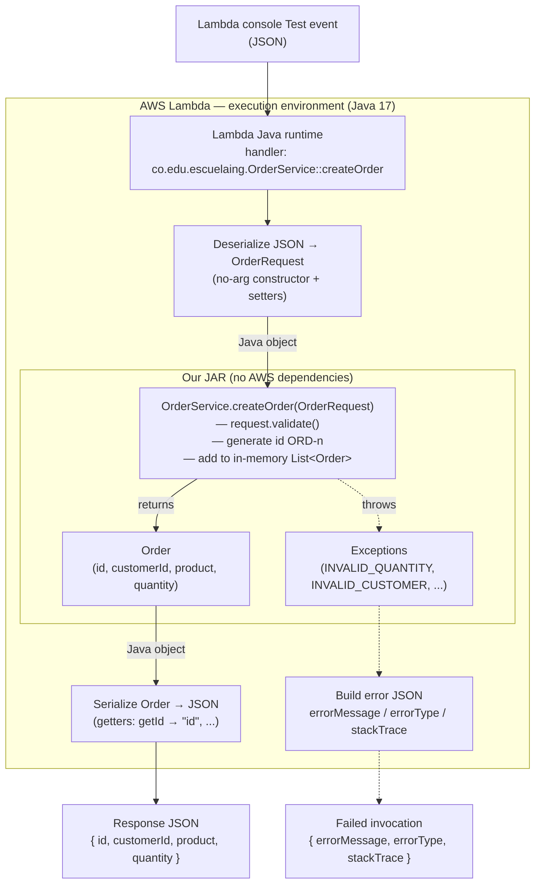

# Serverless REST API with AWS Lambda and API Gateway

A small **Order Management API** built with Java 17 and Maven, designed to be deployed on AWS Lambda and exposed through Amazon API Gateway.

The application logic is written in plain Java first (no HTTP, no AWS classes, no Spring Boot, no web server), so it can be tested locally with JUnit before any infrastructure is involved.

---

## 1. API Design (Contract)

### Order representation

```json
{
  "id": "ORD-001",
  "customerId": "CUST-42",
  "product": "MacBook Air",
  "quantity": 1
}
```

### Error representation

Every error returned by the API uses the same JSON shape:

```json
{
  "error": "ORDER_NOT_FOUND",
  "message": "Order ORD-999 does not exist"
}
```

| Field     | Description                                                                 |
|-----------|-----------------------------------------------------------------------------|
| `error`   | Stable, machine-readable error code (UPPER_SNAKE_CASE). Clients branch on it. |
| `message` | Human-readable explanation of what went wrong, useful for debugging.         |

Error codes used by the API:

| Error code          | HTTP status | When                                                        |
|---------------------|-------------|-------------------------------------------------------------|
| `INVALID_REQUEST`   | 400         | Body is missing, malformed JSON, or a field is invalid       |
| `MISSING_PARAMETER` | 400         | A required path/query parameter is missing or blank          |
| `ORDER_NOT_FOUND`   | 404         | No order exists with the given id                            |
| `INTERNAL_ERROR`    | 500         | Any unexpected failure (details are logged, not exposed)     |

---

### 1.1 Create an order

| Item                  | Value |
|-----------------------|-------|
| **Method**            | `POST` |
| **URL**               | `/orders` |
| **Path parameters**   | — |
| **Query parameters**  | — |
| **Success status**    | `201 Created` |
| **Response headers**  | `Location: /orders/{id}` |

**Request body**

```json
{
  "customerId": "CUST-42",
  "product": "MacBook Air",
  "quantity": 1
}
```

The client does **not** send the `id`; the server generates it.

Validation rules:
- `customerId` is required and not blank.
- `product` is required and not blank.
- `quantity` is required and must be greater than 0.

**Successful response body** (`201 Created`)

```json
{
  "id": "ORD-001",
  "customerId": "CUST-42",
  "product": "MacBook Air",
  "quantity": 1
}
```

**Error responses**

| Status | `error`           | Example `message`                         |
|--------|-------------------|-------------------------------------------|
| 400    | `INVALID_REQUEST` | `customerId is required`                  |
| 400    | `INVALID_REQUEST` | `quantity must be greater than 0`         |
| 400    | `INVALID_REQUEST` | `Request body is not valid JSON`          |
| 500    | `INTERNAL_ERROR`  | `Unexpected error while creating order`   |

---

### 1.2 Retrieve an order

| Item                  | Value |
|-----------------------|-------|
| **Method**            | `GET` |
| **URL**               | `/orders/{id}` |
| **Path parameters**   | `id` (string, required) — e.g. `ORD-001` |
| **Query parameters**  | — |
| **Request body**      | — |
| **Success status**    | `200 OK` |

**Successful response body** (`200 OK`)

```json
{
  "id": "ORD-001",
  "customerId": "CUST-42",
  "product": "MacBook Air",
  "quantity": 1
}
```

**Error responses**

| Status | `error`             | Example `message`                    |
|--------|---------------------|--------------------------------------|
| 400    | `MISSING_PARAMETER` | `Order id cannot be null or blank`   |
| 404    | `ORDER_NOT_FOUND`   | `Order ORD-999 does not exist`       |
| 500    | `INTERNAL_ERROR`    | `Unexpected error while retrieving order` |

---

### 1.3 Find orders belonging to a customer

| Item                  | Value |
|-----------------------|-------|
| **Method**            | `GET` |
| **URL**               | `/orders?customerId={customerId}` |
| **Path parameters**   | — |
| **Query parameters**  | `customerId` (string, required) — e.g. `CUST-42` |
| **Request body**      | — |
| **Success status**    | `200 OK` |

**Successful response body** (`200 OK`)

```json
[
  {
    "id": "ORD-001",
    "customerId": "CUST-42",
    "product": "MacBook Air",
    "quantity": 1
  },
  {
    "id": "ORD-002",
    "customerId": "CUST-42",
    "product": "Magic Mouse",
    "quantity": 2
  }
]
```

If the customer has no orders, the response is still `200 OK` with an **empty array** `[]`. An empty search result is a valid answer, not an error, so `404` is not used here.

**Error responses**

| Status | `error`             | Example `message`                        |
|--------|---------------------|------------------------------------------|
| 400    | `MISSING_PARAMETER` | `customerId query parameter is required` |
| 500    | `INTERNAL_ERROR`    | `Unexpected error while searching orders` |

---

### 1.4 Status codes summary

| Status                      | Used? | Where |
|-----------------------------|-------|-------|
| `200 OK`                    | Yes   | `GET /orders/{id}`, `GET /orders?customerId=...` |
| `201 Created`               | Yes   | `POST /orders` |
| `204 No Content`            | Not yet | Reserved for a future `DELETE /orders/{id}` (success with no body) |
| `400 Bad Request`           | Yes   | Invalid body, invalid fields, missing parameters |
| `404 Not Found`             | Yes   | `GET /orders/{id}` when the order does not exist |
| `500 Internal Server Error` | Yes   | Any unexpected failure |

> **Note on storage:** orders are kept in an in-memory collection. AWS Lambda execution environments are ephemeral and can be recycled or run in parallel at any time, so this data is **not** persistent and may differ between invocations. A real deployment would need a database (e.g. DynamoDB).

---

## 2. Design Questions

**What are the resources in your API?**
The main resource is **Order**. `/orders` represents the *collection* of orders and `/orders/{id}` represents a *single* order inside that collection. Customers are not exposed as a resource in this version; `customerId` is just an attribute of an order used to filter the collection.

**Why did you choose `/orders/{id}` to retrieve a particular order?**
Because in REST each individual resource should have its own unique URL. The `id` uniquely identifies one order, so it belongs in the path: `/orders/ORD-001` *is* that order. It follows the standard collection/item hierarchy (`/orders` → `/orders/{id}`), is easy to read and cache, and naturally supports `404 Not Found` when the identified resource does not exist.

**Why is `customerId` represented as a query parameter in the search operation?**
Because it does not identify a resource; it **filters** the `/orders` collection. Query parameters are the conventional place for filters, searches, sorting and pagination. The result is still a list of orders (possibly empty), and more filters can be added later (`?customerId=CUST-42&product=...`) without changing the resource path. Putting it in the path (`/orders/CUST-42`) would be confused with an order id.

**What should `POST /orders` return when an order is successfully created?**
`201 Created`, with the full created order in the body (including the server-generated `id`) and a `Location: /orders/{id}` header pointing to the new resource. This lets the client know the id immediately without making another request.

**What should the API return when an order does not exist?**
`404 Not Found` with a consistent error body, for example:

```json
{
  "error": "ORDER_NOT_FOUND",
  "message": "Order ORD-999 does not exist"
}
```

This applies to `GET /orders/{id}`. For the customer search, a customer with no orders returns `200 OK` with `[]`.

**What information should an error response contain?**
- A **stable, machine-readable error code** (`error`) so clients can react programmatically.
- A **human-readable message** (`message`) explaining the problem, ideally mentioning the offending value or field.
- The correct **HTTP status code** on the response itself.

It must **not** expose internal details such as stack traces, class names or infrastructure information. Optionally it could include a timestamp, the request path, or a request/correlation id to help with tracing in CloudWatch logs.

---

## 3. Part I — Plain Java Application

### Project structure

```
serverless-rest-api-with-aws-lambda-and-api-gateway/
├── pom.xml
└── src/
    ├── main/java/co/edu/escuelaing/
    │   ├── Order.java          # Domain entity: id, customerId, product, quantity
    │   ├── OrderRequest.java   # Data needed to create an order (no id)
    │   ├── OrderService.java   # Business logic: create, get by id, find by customer
    │   ├── Exceptions.java     # Domain exception with a type (ORDER_NOT_FOUND, INVALID_*...)
    │   └── Main.java
    └── test/java/co/edu/escuelaing/
        └── OrderServiceTest.java
```

### Application operations

| Operation                                        | Maps to API operation              |
|--------------------------------------------------|------------------------------------|
| `Order createOrder(OrderRequest request)`        | `POST /orders`                     |
| `Order getOrder(String id)`                      | `GET /orders/{id}`                 |
| `List<Order> getOrdersByCustomer(String customerId)` | `GET /orders?customerId={customerId}` |

`OrderService` stores orders in an in-memory `List<Order>`. It has no dependency on HTTP, API Gateway, Lambda, Spring Boot or any web server. Errors are reported with the domain exception `Exceptions`, whose `InnerExceptions` type (e.g. `ORDER_NOT_FOUND`, `INVALID_QUANTITY`) tells what went wrong; translating them into HTTP status codes (400, 404, 500) is the job of a later adapter layer (the Lambda handler / API Gateway), not of the service.

### Build and test

```bash
mvn test      # run JUnit tests
mvn package   # build target/serverless-rest-api-with-aws-lambda-and-api-gateway-1.0-SNAPSHOT.jar
```

Tests cover:
- creation of a valid order;
- retrieval of an existing order;
- behavior when an order does not exist;
- searching orders by customer;
- invalid input (null/blank ids, invalid create requests);
- requests built the way Lambda builds them (no-arg constructor + setters), with missing fields;
- the sample orders loaded by the no-arg constructor (see Part III).

Result: `Tests run: 16, Failures: 0, Errors: 0, Skipped: 0`, `BUILD SUCCESS`.


*(Screenshot taken earlier, when the suite had 14 tests.)*

---

## 4. Checkpoint 1

**Can the application functionality be tested without AWS?**
Yes. `OrderService` is plain Java, so JUnit tests instantiate it directly and call its methods. No AWS account, credentials, Lambda runtime or network is needed; `mvn test` runs everything locally.

**Does your application require a web server?**
No. There is no Tomcat, Jetty, Netty or any HTTP listener. In production, API Gateway receives the HTTP request and Lambda invokes our code directly as a function.

**Does it require Spring Boot?**
No. It uses only the Java standard library (plus JUnit for tests). Avoiding Spring Boot also keeps the JAR small and reduces Lambda cold-start time.

**What does the generated JAR contain?**
The compiled `.class` files of our own code (`Order`, `OrderRequest`, `OrderService`, `Exceptions`, `Exceptions$InnerExceptions`, `Main`) under `co/edu/escuelaing/`, plus `META-INF/` with the `MANIFEST.MF` and Maven metadata (`pom.xml`, `pom.properties`). It does **not** contain test classes or third-party dependencies (it is a "thin" JAR). Once AWS libraries are added for the Lambda handler, a "fat"/shaded JAR will be needed so Lambda has all dependencies.

**Which parts of your application currently know about HTTP?**
None. No class references HTTP requests, responses, status codes, headers or API Gateway events. HTTP concepts exist only in this README's API contract. The mapping from domain results/exceptions to HTTP will be added later in a separate handler layer.

---

## 5. Part II — Java Function on AWS Lambda

### What was deployed

The `createOrder` operation was deployed **without redesigning the application** and **without adding any AWS dependency**. Lambda invokes the existing service method directly.

| Setting            | Value |
|--------------------|-------|
| Function name      | `serverless-rest-api-create-order` |
| Region             | `us-east-1` |
| Runtime            | Java 17 |
| Code               | `target/serverless-rest-api-with-aws-lambda-and-api-gateway-1.0-SNAPSHOT.jar` (built with `mvn clean package`) |
| Handler            | `co.edu.escuelaing.OrderService::createOrder` |
| Memory             | 512 MB |
| Triggers           | None yet (invoked manually; API Gateway is added in the next part) |


`createOrder` was chosen because it is the only operation that works on its own: `getOrder` and `getOrdersByCustomer` need orders that already exist, and a new Lambda execution environment starts with an empty list.

The only changes needed for Lambda were in `OrderRequest`:
- a **public no-arg constructor** and **setters**, because that is how the runtime builds the input object;
- the validation was moved out of the constructor/setters into `OrderRequest.validate()`, which `OrderService.createOrder` calls. If validation stayed in the setters, an exception thrown there would happen *during JSON parsing* and be reported as a deserialization error instead of our domain error. If it stayed only in the constructor, Lambda would skip it entirely.

### Manual invocations

The function was invoked five times from the Lambda console **Test** tab. Invocations 1–4 ran in a row in the same execution environment. Invocation 5 ran after the function was modified, so it got a new environment.

#### 1. Valid order (cold start)

Input:

```json
{ "customerId": "CUST-42", "product": "MacBook Air", "quantity": 1 }
```

Output — `Executing function: succeeded`:

```json
{ "id": "ORD-1", "customerId": "CUST-42", "product": "MacBook Air", "quantity": 1 }
```

Duration 69.56 ms, **Init Duration 390.34 ms**, billed 460 ms.


#### 2. Invalid quantity

Input:

```json
{ "customerId": "CUST-42", "product": "MacBook Air", "quantity": 0 }
```

Output — `Executing function: failed`:

```json
{
  "errorMessage": "Quantity must be > 0",
  "errorType": "co.edu.escuelaing.Exceptions",
  "stackTrace": [
    "co.edu.escuelaing.OrderRequest.validateQuantity(OrderRequest.java:61)",
    "co.edu.escuelaing.OrderRequest.validate(OrderRequest.java:48)",
    "co.edu.escuelaing.OrderService.createOrder(OrderService.java:21)",
    "java.base/jdk.internal.reflect.NativeMethodAccessorImpl.invoke0(Native Method)",
    "..."
  ]
}
```

Duration 191.51 ms, no Init Duration.


#### 3. Second valid order (warm invocation)

Input:

```json
{ "customerId": "CUST-42", "product": "MacBook Pro", "quantity": 2 }
```

Output — `Executing function: succeeded`:

```json
{ "id": "ORD-2", "customerId": "CUST-42", "product": "MacBook Pro", "quantity": 2 }
```

Duration **2.76 ms**, billed 3 ms, no Init Duration.


#### 4. Null customer id

Input:

```json
{ "customerId": null, "product": "MacBook Pro", "quantity": 2 }
```

Output — `Executing function: failed`:

```json
{
  "errorMessage": "Customer id cannot be null or blank",
  "errorType": "co.edu.escuelaing.Exceptions",
  "stackTrace": [
    "co.edu.escuelaing.OrderRequest.validateCustomerId(OrderRequest.java:53)",
    "co.edu.escuelaing.OrderRequest.validate(OrderRequest.java:46)",
    "co.edu.escuelaing.OrderService.createOrder(OrderService.java:21)",
    "java.base/jdk.internal.reflect.NativeMethodAccessorImpl.invoke0(Native Method)",
    "..."
  ]
}
```

Duration 23.79 ms, no Init Duration (still the same warm environment).


#### 5. Valid order in a new execution environment

Input (a different customer):

```json
{ "customerId": "CUST-45", "product": "MacBook Pro", "quantity": 2 }
```

Output — `Executing function: succeeded`:

```json
{ "id": "ORD-1", "customerId": "CUST-45", "product": "MacBook Pro", "quantity": 2 }
```

Duration 59.62 ms, **Init Duration 360.13 ms**, billed 420 ms. The function had been modified just before this invocation, so Lambda discarded the old environment and started a new one. The new `OrderService` instance has an empty list, so the id is back at **`ORD-1`**, even though two orders had been created before.


### Investigation: how does the Lambda Java runtime convert JSON ↔ Java?

*Investigated with an LLM, then checked against the deployed function.*

**1. Locating the code.** The handler string `co.edu.escuelaing.OrderService::createOrder` tells the runtime which class to load from the JAR and which method to call. During the **init phase** the runtime loads the class and creates **one instance** with its public no-arg constructor. It then finds the method by name using **Java reflection**. The handler method may take one input parameter, plus an optional `com.amazonaws.services.lambda.runtime.Context`.

**2. JSON → Java (input).** The runtime looks at the **declared type of the method's parameter** (`OrderRequest`) and deserializes the event JSON into it with its built-in serializer (a JSON library bundled in the runtime, based on Jackson). For a POJO it follows JavaBean conventions:
- it creates the object with the **no-arg constructor**;
- for each JSON property it calls the matching **setter** (`"customerId"` → `setCustomerId(...)`, `"quantity"` → `setQuantity(int)`), converting JSON types to Java types (a JSON number becomes an `int`, a JSON string becomes a `String`);
- a property that is **missing** from the JSON is never set, so the field keeps its default value (`null` for objects, `0` for `int`).

Besides POJOs, the runtime can also map JSON to `String`, primitives and wrappers, `Map` and `List`. A handler can skip this conversion entirely by implementing `RequestStreamHandler` and reading the raw `InputStream`.

**3. Calling the function.** The runtime invokes `createOrder(request)` on the **same instance** for every invocation handled by that execution environment.

**4. Java → JSON (output).** The returned object (`Order`) is serialized with the same serializer by reading its **getters**: `getId()` → `"id"`, `getCustomerId()` → `"customerId"`, and so on. The JSON property names come from the **getter names, not the field names**. That is why the getter had to be renamed from `getOrderId()` to `getId()` to get `"id"` in the response.

**5. Exceptions.** If the method throws, the runtime catches the exception and returns an error document instead of the result: `errorMessage` = `getMessage()`, `errorType` = the exception's fully qualified class name, `stackTrace` = the stack frames. The invocation is marked as failed. This is a Lambda error, **not** an HTTP response: there is no status code yet.

#### Verification against the deployed Lambda

| Claim | Evidence from the invocations |
|-------|-------------------------------|
| JSON input is mapped to `OrderRequest` through setters | Invocations 1 and 3: the values from the JSON (`CUST-42`, `MacBook Pro`, `2`) appear in the created order. |
| JSON number → `int` | `"quantity": 2` arrived as the int `2`. In invocation 2, `0` reached `validateQuantity` as an int and was rejected. |
| The return value is serialized from getters | The response contains `"id"`, the name taken from `getId()`, even though the class is `Order` and nothing in it is annotated. |
| The handler is invoked by reflection | The stack trace of invocation 2 shows `NativeMethodAccessorImpl.invoke` right below `OrderService.createOrder`. |
| Exceptions become `errorMessage` / `errorType` / `stackTrace` | Invocation 2: `"errorMessage": "Quantity must be > 0"`, `"errorType": "co.edu.escuelaing.Exceptions"`. |
| Validation happens in our code, not during parsing | In invocations 2 and 4 the stack trace starts in `OrderRequest.validate` ← `OrderService.createOrder`, not in the JSON deserializer. |
| A JSON `null` reaches the object as a Java `null` | Invocation 4: `"customerId": null` was deserialized without error, and our `validateCustomerId` rejected it with `"Customer id cannot be null or blank"`. A property that is completely omitted ends in the same state (`null`). That case is covered by the unit test `shouldRejectRequestBuiltWithSettersMissingCustomer`. |
| One instance is created at init and reused | Only invocation 1 reports an **Init Duration** (390.34 ms) among invocations 1–4. Invocation 3 returned **`ORD-2`**, so the `orders` list from invocation 1 was still in memory. The failed invocation 2 did not add an order, so it did not consume an id. |
| In-memory state is not persistent | Invocation 5, after the function was modified, shows a new **Init Duration** (360.13 ms) and returned **`ORD-1`** again. The orders created before were lost with the old environment. The same happens after an idle timeout, or when concurrent requests are served by a different environment. |

**Conclusion.** The Lambda Java runtime acts as an adapter between JSON and plain Java. It reads the handler string, creates the class once, and uses reflection to call the method. Before the call it deserializes the event JSON into the parameter type using the no-arg constructor and setters. After the call it serializes the return value into JSON using its getters. If the method throws, it turns the exception into an error JSON. Our code never sees JSON, so the same `OrderService` is used unchanged by JUnit and by Lambda. The cost is that the input classes must follow JavaBean conventions, and the instance, with its in-memory data, lives only as long as the execution environment.

---

## 6. Checkpoint 2 — Architecture diagram



The conceptual flow required by the checkpoint, mapped to the real classes:

```
JSON  {"customerId":"CUST-42","product":"MacBook Air","quantity":1}
  |
  v
AWS Lambda Runtime        (handler co.edu.escuelaing.OrderService::createOrder)
  |
  v
Java Object               OrderRequest  (new OrderRequest() + setters)
  |
  v
Java Function             OrderService.createOrder(OrderRequest)
  |
  v
Java Object               Order  (or a thrown Exceptions)
  |
  v
JSON  {"id":"ORD-1","customerId":"CUST-42","product":"MacBook Air","quantity":1}
```

At this stage there is still **no HTTP** anywhere: the function is invoked with a raw JSON event, and errors are Lambda errors, not status codes. Exposing it over HTTP is the job of API Gateway in the next part.

---

## 7. Part III — HTTP Interface with API Gateway (`GET /orders/{id}`)

### Architecture

```
Client (browser / curl)
   |
   | HTTP  GET /dev/orders/ORD-42
   v
API Gateway (REST API, stage "dev")
   |   resource /orders/{id}, method GET
   |   integration request: mapping template extracts {id}
   |
   | Lambda event:  "ORD-42"        (just a JSON string)
   v
Lambda  serverless-rest-api-get-order
   |   handler co.edu.escuelaing.OrderService::getOrder
   v
Java application  OrderService.getOrder(String id)  ->  Order
```

### Changes to the Java application

None in the business logic. `OrderService.getOrder(String id)` is used exactly as it was written in Part I. It receives the id as a plain `String` and knows nothing about paths, HTTP methods or headers.

The only change was **sample data**. Every Lambda function has its own execution environments, and a new environment starts with an empty list. The orders created by `serverless-rest-api-create-order` are therefore not visible to the get function, so there would be nothing to retrieve. As the workshop allows predefined data:

- the no-arg constructor (the one Lambda uses) loads three sample orders:

  | id       | customerId | product     | quantity |
  |----------|------------|-------------|----------|
  | `ORD-42` | `CUST-42`  | MacBook Air | 1        |
  | `ORD-43` | `CUST-42`  | Magic Mouse | 2        |
  | `ORD-44` | `CUST-7`   | iPad        | 1        |

- a new constructor `OrderService(List<Order> initialOrders)` lets the unit tests start from an empty list.

### Configuration

| Component | Setting |
|-----------|---------|
| Lambda function | `serverless-rest-api-get-order`, Java 17, same JAR as Part II |
| Lambda handler | `co.edu.escuelaing.OrderService::getOrder` |
| API type | **REST API**. HTTP APIs do not support mapping templates for Lambda integrations; they only offer proxy integration. |
| Resources | `/` → `/orders` → `/{id}` |
| Method | `GET` on `/orders/{id}` |
| Integration type | Lambda function, **Lambda proxy integration disabled** (custom integration) |
| Integration request mapping template | Content-Type `application/json`: `"$util.escapeJavaScript($input.params('id'))"` |
| Integration response | Default (no customization yet) |
| Stage | `dev` |
| Invoke URL | `https://sat85gcah9.execute-api.us-east-1.amazonaws.com/dev` |


### Evidence

#### 1. The Lambda alone, with a JSON string as event

Before connecting API Gateway, the function was tested in the Lambda console with the event `"ORD-42"`. The event is only a JSON string, not an object. The runtime deserialized it into the `String id` parameter of `getOrder`:

```json
{ "id": "ORD-42", "customerId": "CUST-42", "product": "MacBook Air", "quantity": 1 }
```


#### 2. API Gateway console test

Test of `GET /orders/{id}` with path parameter `id = ORD-42`: status **200**, body `{"id":"ORD-42","customerId":"CUST-42","product":"MacBook Air","quantity":1}`.

The execution log shows how the request was processed:

```
HTTP Method: GET, Resource Path: /orders/ORD-42
Method request path: {id=ORD-42}
Method request query string: {}
Method request headers: {}
Method request body before transformations:
Endpoint request URI: https://lambda.us-east-1.amazonaws.com/2015-03-31/functions/arn:aws:lambda:us-east-1:<account-id>:function:serverless-rest-api-get-order/invocations
```


#### 3. Deployed API called over HTTP

| Request | Status | Body |
|---------|--------|------|
| `GET /dev/orders/ORD-42`  | 200 | `{"id":"ORD-42","customerId":"CUST-42","product":"MacBook Air","quantity":1}` |
| `GET /dev/orders/ORD-43`  | 200 | `{"id":"ORD-43","customerId":"CUST-42","product":"Magic Mouse","quantity":2}` |
| `GET /dev/orders/ORD-999` | **200** | `{"errorMessage":"Order with id ORD-999 was not Found","errorType":"co.edu.escuelaing.Exceptions","stackTrace":[...]}` |


The status codes were checked with `curl -i`:

```
$ curl -i https://sat85gcah9.execute-api.us-east-1.amazonaws.com/dev/orders/ORD-42
HTTP/2 200
content-type: application/json

{"id":"ORD-42","customerId":"CUST-42","product":"MacBook Air","quantity":1}

$ curl -i https://sat85gcah9.execute-api.us-east-1.amazonaws.com/dev/orders/ORD-999
HTTP/2 200
content-type: application/json

{"errorMessage":"Order with id ORD-999 was not Found","errorType":"co.edu.escuelaing.Exceptions","stackTrace":["co.edu.escuelaing.OrderService.getOrder(OrderService.java:55)", ...]}
```

### Investigation: how does API Gateway extract `{id}` and transform the request?

*Investigated with an LLM, then checked against the deployed API.*

With a **custom (non-proxy) integration**, a REST API processes each request in four stages. Each stage is configured separately:

```
Method request  ->  Integration request  ->  Lambda  ->  Integration response  ->  Method response
```

**1. Method request: matching the route and capturing the path parameter.** The resource `/orders/{id}` declares a **path parameter** named `id`. When `GET /orders/ORD-42` arrives, API Gateway matches the URL against the resource tree and binds `id = ORD-42`. The log line `Method request path: {id=ORD-42}` shows exactly this. The value is only stored in the request context at this point; nothing has been sent to Lambda yet.

**2. Integration request: building the Lambda event with a mapping template.** With proxy integration disabled, API Gateway does not forward the HTTP request. Instead it **builds a new payload** from a *mapping template*, written in **VTL (Velocity Template Language)**. The template is chosen by the request's `Content-Type`. When the request has no `Content-Type`, which is always the case for a browser `GET`, API Gateway uses the `application/json` template.

Our template is:

```
"$util.escapeJavaScript($input.params('id'))"
```

- `$input.params('id')` returns the value of the request parameter `id`. It searches the **path**, then the **query string**, then the **headers**, in that order. A more explicit form is `$input.params().path.get('id')`.
- `$util.escapeJavaScript(...)` escapes characters such as `"` and `\`. Without it, an id containing a quote would produce invalid JSON.
- The surrounding quotes make the result a **JSON string**.

For `GET /orders/ORD-42` the template produces the payload `"ORD-42"`. The client sent no body at all (`Method request body before transformations:` is empty), so the body Lambda receives was **created entirely by API Gateway**.

**3. Lambda.** The Lambda Java runtime deserializes the event `"ORD-42"` into the `String` parameter of `getOrder`, exactly as in Part II. The Java code receives `ORD-42` and nothing else: no URL, no method, no headers.

**4. Integration response and method response: building the HTTP response.** The value returned by Lambda (`Order` serialized to JSON) goes through the integration response. No response template is configured, so it is passed through **unchanged** with the default status **200** and `Content-Type: application/json`.

**What a custom integration could also do.** The same mapping mechanism could build richer events, for example `{"id": "$input.params('id')", "requestedBy": "$context.identity.sourceIp"}`. It could map query strings and headers, or reshape the Lambda result in the integration response. All of that lives in API Gateway configuration, not in Java.

**Comparison with proxy integration.** With *Lambda proxy integration* enabled, there is no mapping template. API Gateway sends the **whole HTTP request** as a large JSON event (`httpMethod`, `path`, `pathParameters`, `queryStringParameters`, `headers`, `body`, `requestContext`, …). Lambda must then return an object with `statusCode`, `headers` and `body`. The Java code would have to understand HTTP, through an adapter class such as one that takes an `APIGatewayProxyRequestEvent`. With the custom integration, that responsibility stays in API Gateway and `OrderService` stays plain Java.

#### Verification against the deployed API

| Claim | Evidence |
|-------|----------|
| API Gateway extracts `{id}` from the path | Test log: `Method request path: {id=ORD-42}` for resource path `/orders/ORD-42`. |
| The Lambda event is built by the mapping template, not sent by the client | Test log: `Method request body before transformations:` is **empty**, yet Lambda received the id. |
| The event is a plain JSON string that maps to `String id` | `getOrder(String)` returned the right order. The same function tested directly with the event `"ORD-42"` returned the same result. If Lambda had received the full HTTP request (proxy), deserializing an object into a `String` would have failed. |
| Different path values reach the Java code | `ORD-42` and `ORD-43` returned their respective orders. |
| The Java application does not know about HTTP | `OrderService.getOrder` was not modified. It still takes only a `String`. |
| Without integration-response configuration, everything becomes `200` | `curl -i .../orders/ORD-999` returned **`HTTP/2 200`** with the Lambda error document as the body. |

### Problems found (to address in the next part)

1. **A missing order returns `200 OK`, not `404 Not Found`.** With a custom integration, a Lambda error is not an HTTP error by itself. API Gateway needs an **integration response** whose *Lambda error regex* matches the `errorMessage` (e.g. `.*not Found.*`) and maps it to `404`, plus a response template that builds `{"error": "ORDER_NOT_FOUND", "message": "..."}`. Making error messages start with the error code (e.g. `ORDER_NOT_FOUND: Order ORD-999 does not exist`) would make those regexes more reliable.
2. **The response leaks internal details.** The body exposes `errorType` (a Java class name) and a `stackTrace` with source file names and line numbers. The error contract in section 1 says clients should receive only `error` and `message`.
3. **The error body does not follow the contract.** It uses Lambda's format (`errorMessage` / `errorType`) instead of `error` / `message`.

All three are API Gateway configuration problems, not Java problems: the Java code correctly reports *what* went wrong through the exception, and it is the integration layer's job to translate that into HTTP.
