# Serverless REST API with AWS Lambda and API Gateway

A small **Order Management API** built with Java 17 and Maven, designed to be deployed on AWS Lambda and exposed through Amazon API Gateway.

The application logic is written in plain Java first (no HTTP, no AWS classes, no Spring Boot, no web server), so it can be tested locally with JUnit before any infrastructure is involved.

### Quick start

```bash
mvn test      # 42 unit tests (business logic + HTTP adapter), no AWS needed
mvn package   # target/serverless-rest-api-with-aws-lambda-and-api-gateway-1.0-SNAPSHOT.jar (shaded)

API=https://0lx1iz642k.execute-api.us-east-1.amazonaws.com/dev     # final API (proxy integration)
curl -i -X POST $API/orders -H "Content-Type: application/json" \
     -d '{"customerId":"CUST-42","product":"MacBook Air","quantity":1}'   # 201
curl -i $API/orders/ORD-43                                              # 200
curl -i "$API/orders?customerId=CUST-42"                                # 200
curl -i -X DELETE $API/orders/ORD-44                                    # 204
curl -i $API/orders/ORD-999                                             # 404
```

Demo video: [https://youtu.be/SnaeQFPZY9A](https://youtu.be/SnaeQFPZY9A). Final architecture: see the [diagram in section 19](#19-final-architecture-diagram). How to reproduce the deployment: [section 20](#20-reproducing-the-deployment-and-deliverables).

### Contents

| # | Section | Workshop part |
|---|---------|---------------|
| 1–2 | [API contract](#1-api-design-contract) and [design questions](#2-design-questions) | 4 |
| 3–4 | [Plain Java application](#3-part-i--plain-java-application), [Checkpoint 1](#4-checkpoint-1) | 5–6 |
| 5–6 | [Java function on Lambda](#5-part-ii--java-function-on-aws-lambda), JSON ↔ Java investigation, [Checkpoint 2](#6-checkpoint-2--architecture-diagram) | 7 |
| 7 | [API Gateway path extraction](#7-part-iii--http-interface-with-api-gateway-get-ordersid) | 8 |
| 8–10 | [Mapping templates](#8-part-iv--api-gateway-mapping-non-proxy-integration), [HTTP semantics](#9-http-semantics--test-results), [Checkpoint 3](#10-checkpoint-3--who-is-responsible-for-what) | 9–10 |
| 11–13 | [Proxy integration](#11-part-v--lambda-proxy-integration), [HTTP adapter](#12-http-adapter), [HTTP responses](#13-http-responses--test-results-architecture-b) | 11–13 |
| 14 | [Comparison of the two architectures](#14-comparing-the-two-architectures) | 14 |
| 15–16 | [AI-assisted development](#15-ai-assisted-development), [criticizing the agent](#16-criticizing-the-agent) | 15–16 |
| 17–18 | [DELETE extension](#17-final-challenge--delete-ordersid), [final API](#18-final-api) | 17–18 |
| 19–22 | [Final diagram](#19-final-architecture-diagram), [reproduction and deliverables](#20-reproducing-the-deployment-and-deliverables), [demonstration](#21-demonstration), [where each responsibility lives](#22-the-main-question-where-should-each-responsibility-live) | 19–23 |

---

## 1. API Design (Contract)

### Order representation

```json
{
  "id": "ORD-001",
  "customerId": "CUST-42",
  "product": "MacBook Air",
  "quantity": 1
}
```

### Error representation

Every error returned by the API uses the same JSON shape:

```json
{
  "error": "ORDER_NOT_FOUND",
  "message": "Order ORD-999 does not exist"
}
```

| Field     | Description                                                                 |
|-----------|-----------------------------------------------------------------------------|
| `error`   | Stable, machine-readable error code (UPPER_SNAKE_CASE). Clients branch on it. |
| `message` | Human-readable explanation of what went wrong, useful for debugging.         |

Error codes used by the API:

| Error code         | HTTP status | When                                                          |
|--------------------|-------------|---------------------------------------------------------------|
| `INVALID_CUSTOMER` | 400         | `customerId` is missing or blank (body or query parameter)    |
| `INVALID_PRODUCT`  | 400         | `product` is missing or blank                                 |
| `INVALID_QUANTITY` | 400         | `quantity` is missing or not greater than 0                   |
| `INVALID_ORDER`    | 400         | The order id is blank, or the request body is missing         |
| `ORDER_NOT_FOUND`  | 404         | No order exists with the given id                             |
| `INTERNAL_ERROR`   | 500         | Any unexpected failure (details are logged, not exposed)      |

The codes are the values of the Java enum `Exceptions.InnerExceptions` (except `INTERNAL_ERROR`), so the code a client sees is the code the application raised.

---

### 1.1 Create an order

| Item                  | Value |
|-----------------------|-------|
| **Method**            | `POST` |
| **URL**               | `/orders` |
| **Path parameters**   | — |
| **Query parameters**  | — |
| **Success status**    | `201 Created` |
| **Response headers**  | `Location: /orders/{id}` (planned, not configured yet) |

**Request body**

```json
{
  "customerId": "CUST-42",
  "product": "MacBook Air",
  "quantity": 1
}
```

The client does **not** send the `id`; the server generates it.

Validation rules:
- `customerId` is required and not blank.
- `product` is required and not blank.
- `quantity` is required and must be greater than 0.

**Successful response body** (`201 Created`)

```json
{
  "id": "ORD-001",
  "customerId": "CUST-42",
  "product": "MacBook Air",
  "quantity": 1
}
```

**Error responses**

| Status | `error`           | Example `message`                         |
|--------|-------------------|-------------------------------------------|
| 400    | `INVALID_CUSTOMER` | `Customer id cannot be null or blank`             |
| 400    | `INVALID_PRODUCT`  | `Product cannot be null or blank`                 |
| 400    | `INVALID_QUANTITY` | `Quantity must be > 0`                            |
| 500    | `INTERNAL_ERROR`   | `Unexpected error while processing the request`   |

---

### 1.2 Retrieve an order

| Item                  | Value |
|-----------------------|-------|
| **Method**            | `GET` |
| **URL**               | `/orders/{id}` |
| **Path parameters**   | `id` (string, required) — e.g. `ORD-001` |
| **Query parameters**  | — |
| **Request body**      | — |
| **Success status**    | `200 OK` |

**Successful response body** (`200 OK`)

```json
{
  "id": "ORD-001",
  "customerId": "CUST-42",
  "product": "MacBook Air",
  "quantity": 1
}
```

**Error responses**

| Status | `error`             | Example `message`                    |
|--------|---------------------|--------------------------------------|
| 400    | `INVALID_ORDER`     | `Order id cannot be null or blank`   |
| 404    | `ORDER_NOT_FOUND`   | `Order ORD-999 does not exist`       |
| 500    | `INTERNAL_ERROR`    | `Unexpected error while processing the request` |

---

### 1.3 Find orders belonging to a customer

| Item                  | Value |
|-----------------------|-------|
| **Method**            | `GET` |
| **URL**               | `/orders?customerId={customerId}` |
| **Path parameters**   | — |
| **Query parameters**  | `customerId` (string, required) — e.g. `CUST-42` |
| **Request body**      | — |
| **Success status**    | `200 OK` |

**Successful response body** (`200 OK`)

```json
[
  {
    "id": "ORD-001",
    "customerId": "CUST-42",
    "product": "MacBook Air",
    "quantity": 1
  },
  {
    "id": "ORD-002",
    "customerId": "CUST-42",
    "product": "Magic Mouse",
    "quantity": 2
  }
]
```

If the customer has no orders, the response is still `200 OK` with an **empty array** `[]`. An empty search result is a valid answer, not an error, so `404` is not used here.

**Error responses**

| Status | `error`             | Example `message`                        |
|--------|---------------------|------------------------------------------|
| 400    | `INVALID_CUSTOMER`  | `Customer id cannot be blank or null` |
| 500    | `INTERNAL_ERROR`    | `Unexpected error while processing the request` |

---

### 1.4 Status codes summary

| Status                      | Used? | Where |
|-----------------------------|-------|-------|
| `200 OK`                    | Yes   | `GET /orders/{id}`, `GET /orders?customerId=...` |
| `201 Created`               | Yes   | `POST /orders` |
| `204 No Content`            | Yes   | `DELETE /orders/{id}` (added in section 17, proxy API only) |
| `400 Bad Request`           | Yes   | Invalid body, invalid fields, missing parameters |
| `404 Not Found`             | Yes   | `GET /orders/{id}` when the order does not exist |
| `500 Internal Server Error` | Yes   | Any unexpected failure |

> **Note on storage:** orders are kept in an in-memory collection. AWS Lambda execution environments are ephemeral and can be recycled or run in parallel at any time, so this data is **not** persistent and may differ between invocations. A real deployment would need a database (e.g. DynamoDB).

---

## 2. Design Questions

**What are the resources in your API?**
The main resource is **Order**. `/orders` represents the *collection* of orders and `/orders/{id}` represents a *single* order inside that collection. Customers are not exposed as a resource in this version; `customerId` is just an attribute of an order used to filter the collection.

**Why did you choose `/orders/{id}` to retrieve a particular order?**
Because in REST each individual resource should have its own unique URL. The `id` uniquely identifies one order, so it belongs in the path: `/orders/ORD-001` *is* that order. It follows the standard collection/item hierarchy (`/orders` → `/orders/{id}`), is easy to read and cache, and naturally supports `404 Not Found` when the identified resource does not exist.

**Why is `customerId` represented as a query parameter in the search operation?**
Because it does not identify a resource; it **filters** the `/orders` collection. Query parameters are the conventional place for filters, searches, sorting and pagination. The result is still a list of orders (possibly empty), and more filters can be added later (`?customerId=CUST-42&product=...`) without changing the resource path. Putting it in the path (`/orders/CUST-42`) would be confused with an order id.

**What should `POST /orders` return when an order is successfully created?**
`201 Created`, with the full created order in the body (including the server-generated `id`) and a `Location: /orders/{id}` header pointing to the new resource. This lets the client know the id immediately without making another request.

**What should the API return when an order does not exist?**
`404 Not Found` with a consistent error body, for example:

```json
{
  "error": "ORDER_NOT_FOUND",
  "message": "Order ORD-999 does not exist"
}
```

This applies to `GET /orders/{id}`. For the customer search, a customer with no orders returns `200 OK` with `[]`.

**What information should an error response contain?**
- A **stable, machine-readable error code** (`error`) so clients can react programmatically.
- A **human-readable message** (`message`) explaining the problem, ideally mentioning the offending value or field.
- The correct **HTTP status code** on the response itself.

It must **not** expose internal details such as stack traces, class names or infrastructure information. Optionally it could include a timestamp, the request path, or a request/correlation id to help with tracing in CloudWatch logs.

---

## 3. Part I — Plain Java Application

### Project structure

```
serverless-rest-api-with-aws-lambda-and-api-gateway/
├── pom.xml
├── README.md
├── docs/                       # screenshots + DELETE prediction
├── events/                     # captured API Gateway proxy event
└── src/
    ├── main/java/co/edu/escuelaing/
    │   ├── Order.java          # Domain entity: id, customerId, product, quantity
    │   ├── OrderRequest.java   # Data needed to create an order (no id)
    │   ├── OrderService.java   # Business logic: create, get, find by customer, delete
    │   ├── Exceptions.java     # Domain exception with a type (ORDER_NOT_FOUND, INVALID_*...)
    │   └── http/
    │       └── OrdersHandler.java   # HTTP adapter for Lambda proxy integration (Part V)
    └── test/java/co/edu/escuelaing/
        ├── OrderServiceTest.java
        └── http/
            └── OrdersHandlerTest.java
```

The `http` package was added in Part V. Everything outside it is the plain-Java application from Part I.

### Application operations

| Operation                                        | Maps to API operation              |
|--------------------------------------------------|------------------------------------|
| `Order createOrder(OrderRequest request)`        | `POST /orders`                     |
| `Order getOrder(String id)`                      | `GET /orders/{id}`                 |
| `List<Order> getOrdersByCustomer(String customerId)` | `GET /orders?customerId={customerId}` |

`OrderService` stores orders in an in-memory `List<Order>`. It has no dependency on HTTP, API Gateway, Lambda, Spring Boot or any web server. Errors are reported with the domain exception `Exceptions`, whose `InnerExceptions` type (e.g. `ORDER_NOT_FOUND`, `INVALID_QUANTITY`) tells what went wrong; translating them into HTTP status codes (400, 404, 500) is the job of a later adapter layer (the Lambda handler / API Gateway), not of the service.

### Build and test

```bash
mvn test      # run JUnit tests
mvn package   # build target/serverless-rest-api-with-aws-lambda-and-api-gateway-1.0-SNAPSHOT.jar
```

Tests cover:
- creation of a valid order;
- retrieval of an existing order;
- behavior when an order does not exist;
- searching orders by customer;
- invalid input (null/blank ids, invalid create requests);
- requests built the way Lambda builds them (no-arg constructor + setters), with missing fields;
- the sample orders loaded by the no-arg constructor (see Part III);
- the `CODE: message` format of error messages that API Gateway relies on (see Part IV).

Result at the end of Part I–IV: `Tests run: 17, Failures: 0, Errors: 0, Skipped: 0`, `BUILD SUCCESS`. The final project has 42 tests (see section 18).

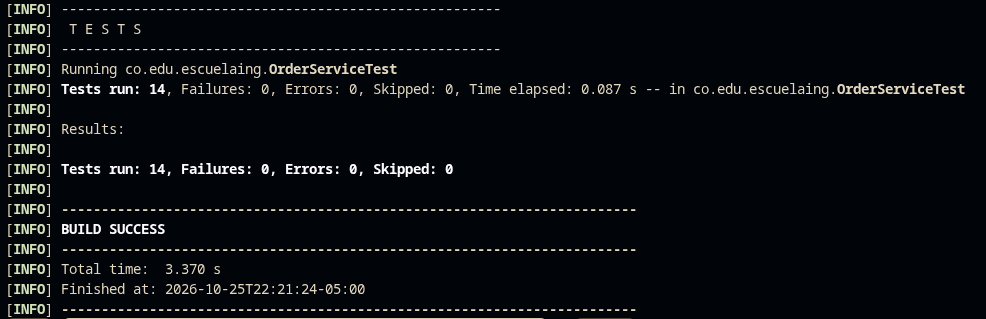

*(Screenshot taken earlier, when the suite had 14 tests.)*

---

## 4. Checkpoint 1

**Can the application functionality be tested without AWS?**
Yes. `OrderService` is plain Java, so JUnit tests instantiate it directly and call its methods. No AWS account, credentials, Lambda runtime or network is needed; `mvn test` runs everything locally.

**Does your application require a web server?**
No. There is no Tomcat, Jetty, Netty or any HTTP listener. In production, API Gateway receives the HTTP request and Lambda invokes our code directly as a function.

**Does it require Spring Boot?**
No. It uses only the Java standard library (plus JUnit for tests). Avoiding Spring Boot also keeps the JAR small and reduces Lambda cold-start time.

**What does the generated JAR contain?**
The compiled `.class` files of our own code (`Order`, `OrderRequest`, `OrderService`, `Exceptions`, `Exceptions$InnerExceptions`, `Main`) under `co/edu/escuelaing/`, plus `META-INF/` with the `MANIFEST.MF` and Maven metadata (`pom.xml`, `pom.properties`). It does **not** contain test classes or third-party dependencies (it is a "thin" JAR). Once AWS libraries are added for the Lambda handler, a "fat"/shaded JAR will be needed so Lambda has all dependencies.

**Which parts of your application currently know about HTTP?**
None. No class references HTTP requests, responses, status codes, headers or API Gateway events. HTTP concepts exist only in this README's API contract. The mapping from domain results/exceptions to HTTP will be added later in a separate handler layer.

---

## 5. Part II — Java Function on AWS Lambda

### What was deployed

The `createOrder` operation was deployed **without redesigning the application** and **without adding any AWS dependency**. Lambda invokes the existing service method directly.

| Setting            | Value |
|--------------------|-------|
| Function name      | `serverless-rest-api-create-order` |
| Region             | `us-east-1` |
| Runtime            | Java 17 |
| Code               | `target/serverless-rest-api-with-aws-lambda-and-api-gateway-1.0-SNAPSHOT.jar` (built with `mvn clean package`) |
| Handler            | `co.edu.escuelaing.OrderService::createOrder` |
| Memory             | 512 MB |
| Triggers           | None yet (invoked manually; API Gateway is added in the next part) |

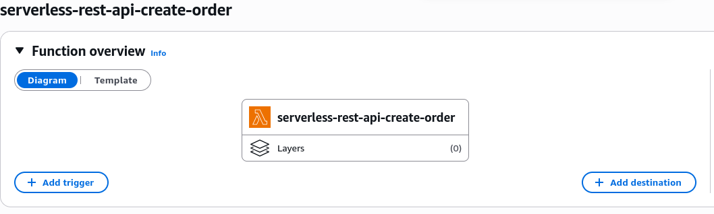

`createOrder` was chosen because it is the only operation that works on its own: `getOrder` and `getOrdersByCustomer` need orders that already exist, and a new Lambda execution environment starts with an empty list.

The only changes needed for Lambda were in `OrderRequest`:
- a **public no-arg constructor** and **setters**, because that is how the runtime builds the input object;
- the validation was moved out of the constructor/setters into `OrderRequest.validate()`, which `OrderService.createOrder` calls. If validation stayed in the setters, an exception thrown there would happen *during JSON parsing* and be reported as a deserialization error instead of our domain error. If it stayed only in the constructor, Lambda would skip it entirely.

### Manual invocations

The function was invoked five times from the Lambda console **Test** tab. Invocations 1–4 ran in a row in the same execution environment. Invocation 5 ran after the function was modified, so it got a new environment.

#### 1. Valid order (cold start)

Input:

```json
{ "customerId": "CUST-42", "product": "MacBook Air", "quantity": 1 }
```

Output — `Executing function: succeeded`:

```json
{ "id": "ORD-1", "customerId": "CUST-42", "product": "MacBook Air", "quantity": 1 }
```

Duration 69.56 ms, **Init Duration 390.34 ms**, billed 460 ms.

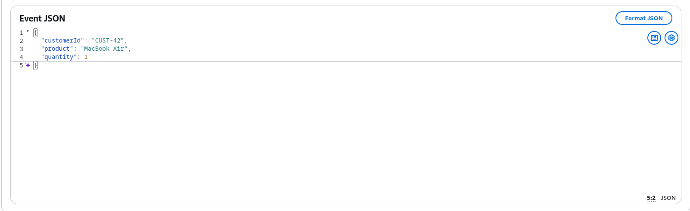
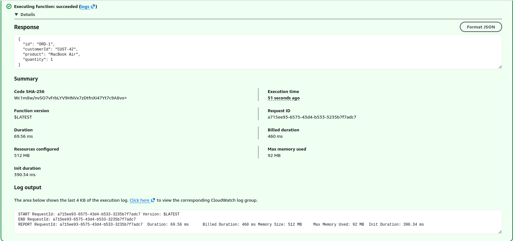

#### 2. Invalid quantity

Input:

```json
{ "customerId": "CUST-42", "product": "MacBook Air", "quantity": 0 }
```

Output — `Executing function: failed`:

```json
{
  "errorMessage": "Quantity must be > 0",
  "errorType": "co.edu.escuelaing.Exceptions",
  "stackTrace": [
    "co.edu.escuelaing.OrderRequest.validateQuantity(OrderRequest.java:61)",
    "co.edu.escuelaing.OrderRequest.validate(OrderRequest.java:48)",
    "co.edu.escuelaing.OrderService.createOrder(OrderService.java:21)",
    "java.base/jdk.internal.reflect.NativeMethodAccessorImpl.invoke0(Native Method)",
    "..."
  ]
}
```

Duration 191.51 ms, no Init Duration.

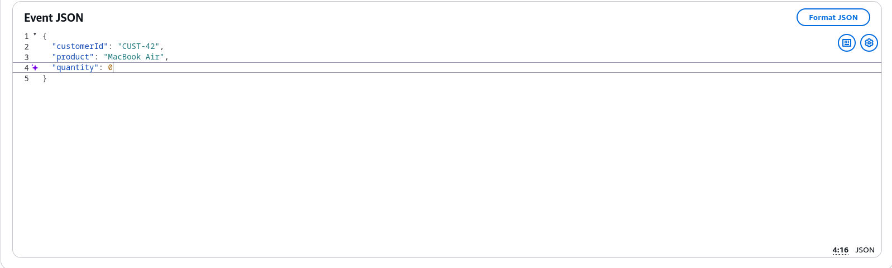
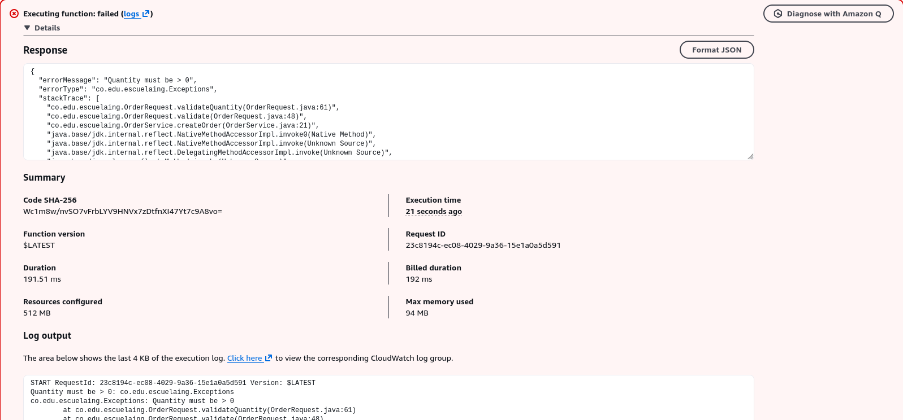

#### 3. Second valid order (warm invocation)

Input:

```json
{ "customerId": "CUST-42", "product": "MacBook Pro", "quantity": 2 }
```

Output — `Executing function: succeeded`:

```json
{ "id": "ORD-2", "customerId": "CUST-42", "product": "MacBook Pro", "quantity": 2 }
```

Duration **2.76 ms**, billed 3 ms, no Init Duration.

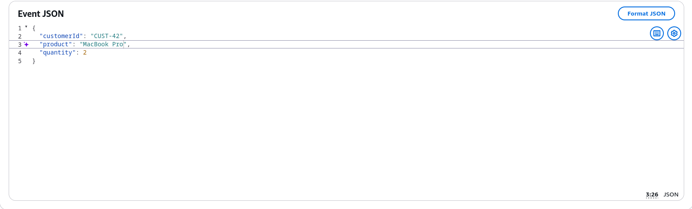
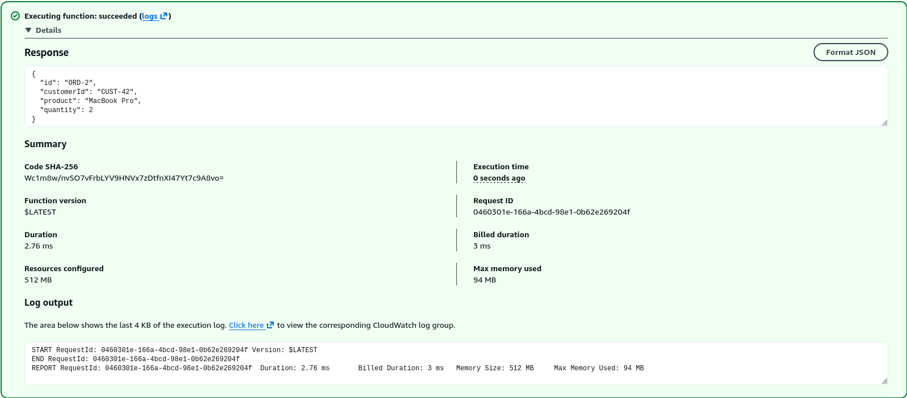

#### 4. Null customer id

Input:

```json
{ "customerId": null, "product": "MacBook Pro", "quantity": 2 }
```

Output — `Executing function: failed`:

```json
{
  "errorMessage": "Customer id cannot be null or blank",
  "errorType": "co.edu.escuelaing.Exceptions",
  "stackTrace": [
    "co.edu.escuelaing.OrderRequest.validateCustomerId(OrderRequest.java:53)",
    "co.edu.escuelaing.OrderRequest.validate(OrderRequest.java:46)",
    "co.edu.escuelaing.OrderService.createOrder(OrderService.java:21)",
    "java.base/jdk.internal.reflect.NativeMethodAccessorImpl.invoke0(Native Method)",
    "..."
  ]
}
```

Duration 23.79 ms, no Init Duration (still the same warm environment).

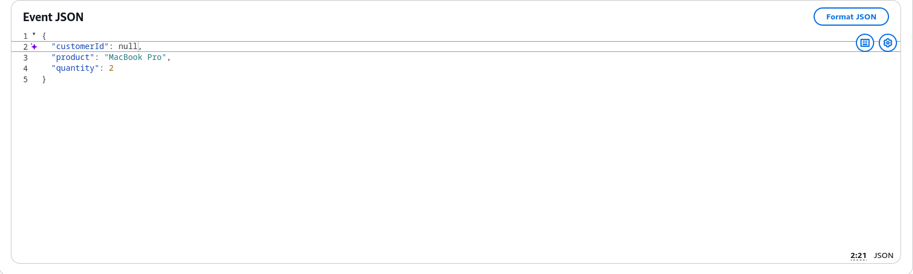
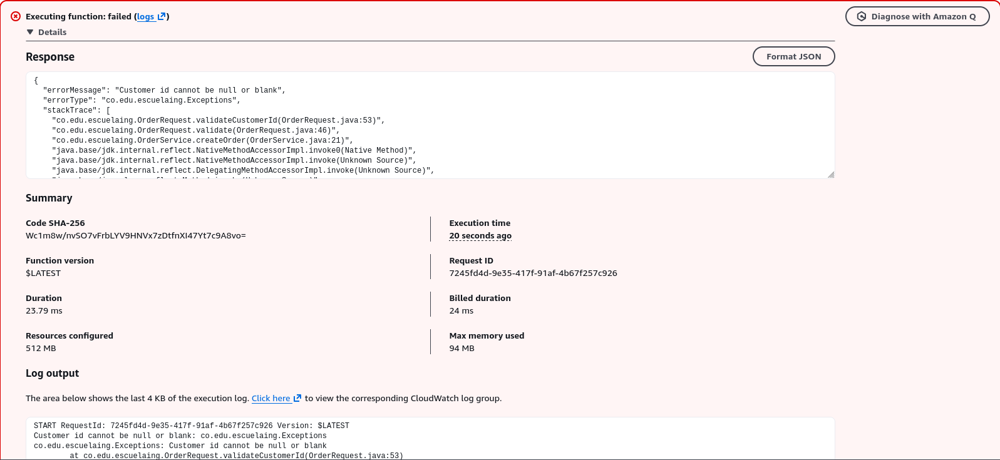

#### 5. Valid order in a new execution environment

Input (a different customer):

```json
{ "customerId": "CUST-45", "product": "MacBook Pro", "quantity": 2 }
```

Output — `Executing function: succeeded`:

```json
{ "id": "ORD-1", "customerId": "CUST-45", "product": "MacBook Pro", "quantity": 2 }
```

Duration 59.62 ms, **Init Duration 360.13 ms**, billed 420 ms. The function had been modified just before this invocation, so Lambda discarded the old environment and started a new one. The new `OrderService` instance has an empty list, so the id is back at **`ORD-1`**, even though two orders had been created before.

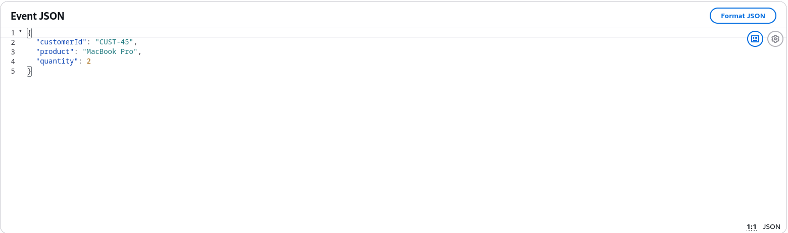
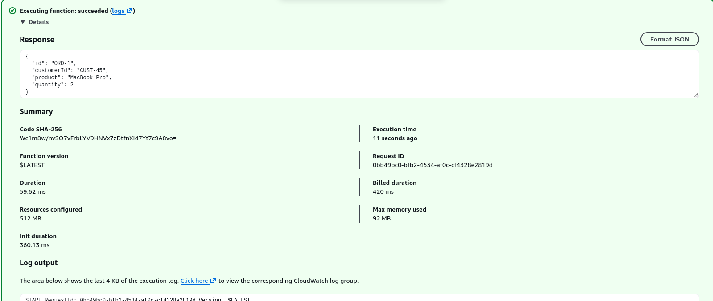

### Investigation: how does the Lambda Java runtime convert JSON ↔ Java?

*Investigated with an LLM, then checked against the deployed function.*

**1. Locating the code.** The handler string `co.edu.escuelaing.OrderService::createOrder` tells the runtime which class to load from the JAR and which method to call. During the **init phase** the runtime loads the class and creates **one instance** with its public no-arg constructor. It then finds the method by name using **Java reflection**. The handler method may take one input parameter, plus an optional `com.amazonaws.services.lambda.runtime.Context`.

**2. JSON → Java (input).** The runtime looks at the **declared type of the method's parameter** (`OrderRequest`) and deserializes the event JSON into it with its built-in serializer (a JSON library bundled in the runtime, based on Jackson). For a POJO it follows JavaBean conventions:
- it creates the object with the **no-arg constructor**;
- for each JSON property it calls the matching **setter** (`"customerId"` → `setCustomerId(...)`, `"quantity"` → `setQuantity(int)`), converting JSON types to Java types (a JSON number becomes an `int`, a JSON string becomes a `String`);
- a property that is **missing** from the JSON is never set, so the field keeps its default value (`null` for objects, `0` for `int`).

Besides POJOs, the runtime can also map JSON to `String`, primitives and wrappers, `Map` and `List`. A handler can skip this conversion entirely by implementing `RequestStreamHandler` and reading the raw `InputStream`.

**3. Calling the function.** The runtime invokes `createOrder(request)` on the **same instance** for every invocation handled by that execution environment.

**4. Java → JSON (output).** The returned object (`Order`) is serialized with the same serializer by reading its **getters**: `getId()` → `"id"`, `getCustomerId()` → `"customerId"`, and so on. The JSON property names come from the **getter names, not the field names**. That is why the getter had to be renamed from `getOrderId()` to `getId()` to get `"id"` in the response.

**5. Exceptions.** If the method throws, the runtime catches the exception and returns an error document instead of the result: `errorMessage` = `getMessage()`, `errorType` = the exception's fully qualified class name, `stackTrace` = the stack frames. The invocation is marked as failed. This is a Lambda error, **not** an HTTP response: there is no status code yet.

#### Verification against the deployed Lambda

| Claim | Evidence from the invocations |
|-------|-------------------------------|
| JSON input is mapped to `OrderRequest` through setters | Invocations 1 and 3: the values from the JSON (`CUST-42`, `MacBook Pro`, `2`) appear in the created order. |
| JSON number → `int` | `"quantity": 2` arrived as the int `2`. In invocation 2, `0` reached `validateQuantity` as an int and was rejected. |
| The return value is serialized from getters | The response contains `"id"`, the name taken from `getId()`, even though the class is `Order` and nothing in it is annotated. |
| The handler is invoked by reflection | The stack trace of invocation 2 shows `NativeMethodAccessorImpl.invoke` right below `OrderService.createOrder`. |
| Exceptions become `errorMessage` / `errorType` / `stackTrace` | Invocation 2: `"errorMessage": "Quantity must be > 0"`, `"errorType": "co.edu.escuelaing.Exceptions"`. |
| Validation happens in our code, not during parsing | In invocations 2 and 4 the stack trace starts in `OrderRequest.validate` ← `OrderService.createOrder`, not in the JSON deserializer. |
| A JSON `null` reaches the object as a Java `null` | Invocation 4: `"customerId": null` was deserialized without error, and our `validateCustomerId` rejected it with `"Customer id cannot be null or blank"`. A property that is completely omitted ends in the same state (`null`). That case is covered by the unit test `shouldRejectRequestBuiltWithSettersMissingCustomer`. |
| One instance is created at init and reused | Only invocation 1 reports an **Init Duration** (390.34 ms) among invocations 1–4. Invocation 3 returned **`ORD-2`**, so the `orders` list from invocation 1 was still in memory. The failed invocation 2 did not add an order, so it did not consume an id. |
| In-memory state is not persistent | Invocation 5, after the function was modified, shows a new **Init Duration** (360.13 ms) and returned **`ORD-1`** again. The orders created before were lost with the old environment. The same happens after an idle timeout, or when concurrent requests are served by a different environment. |

**Conclusion.** The Lambda Java runtime acts as an adapter between JSON and plain Java. It reads the handler string, creates the class once, and uses reflection to call the method. Before the call it deserializes the event JSON into the parameter type using the no-arg constructor and setters. After the call it serializes the return value into JSON using its getters. If the method throws, it turns the exception into an error JSON. Our code never sees JSON, so the same `OrderService` is used unchanged by JUnit and by Lambda. The cost is that the input classes must follow JavaBean conventions, and the instance, with its in-memory data, lives only as long as the execution environment.

---

## 6. Checkpoint 2 — Architecture diagram

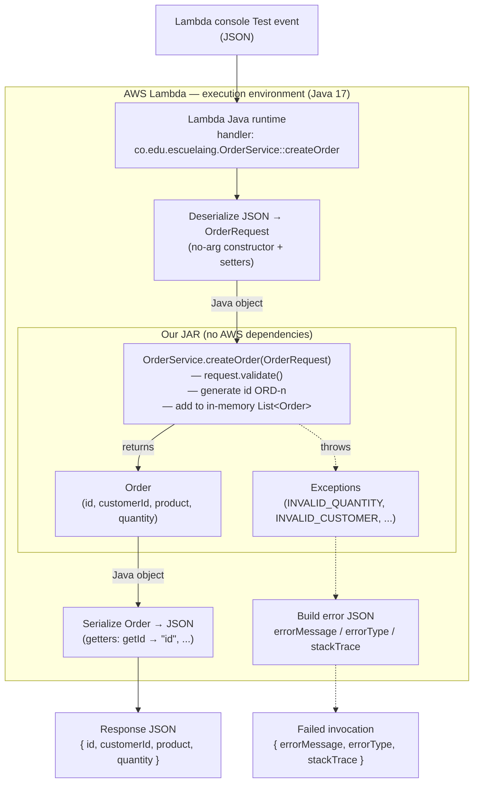

The conceptual flow required by the checkpoint, mapped to the real classes:

```
JSON  {"customerId":"CUST-42","product":"MacBook Air","quantity":1}
  |
  v
AWS Lambda Runtime        (handler co.edu.escuelaing.OrderService::createOrder)
  |
  v
Java Object               OrderRequest  (new OrderRequest() + setters)
  |
  v
Java Function             OrderService.createOrder(OrderRequest)
  |
  v
Java Object               Order  (or a thrown Exceptions)
  |
  v
JSON  {"id":"ORD-1","customerId":"CUST-42","product":"MacBook Air","quantity":1}
```

At this stage there is still **no HTTP** anywhere: the function is invoked with a raw JSON event, and errors are Lambda errors, not status codes. Exposing it over HTTP is the job of API Gateway in the next part.

---

## 7. Part III — HTTP Interface with API Gateway (`GET /orders/{id}`)

### Architecture

```
Client (browser / curl)
   |
   | HTTP  GET /dev/orders/ORD-42
   v
API Gateway (REST API, stage "dev")
   |   resource /orders/{id}, method GET
   |   integration request: mapping template extracts {id}
   |
   | Lambda event:  "ORD-42"        (just a JSON string)
   v
Lambda  serverless-rest-api-get-order
   |   handler co.edu.escuelaing.OrderService::getOrder
   v
Java application  OrderService.getOrder(String id)  ->  Order
```

### Changes to the Java application

None in the business logic. `OrderService.getOrder(String id)` is used exactly as it was written in Part I. It receives the id as a plain `String` and knows nothing about paths, HTTP methods or headers.

The only change was **sample data**. Every Lambda function has its own execution environments, and a new environment starts with an empty list. The orders created by `serverless-rest-api-create-order` are therefore not visible to the get function, so there would be nothing to retrieve. As the workshop allows predefined data:

- the no-arg constructor (the one Lambda uses) loads three sample orders:

  | id       | customerId | product     | quantity |
  |----------|------------|-------------|----------|
  | `ORD-42` | `CUST-42`  | MacBook Air | 1        |
  | `ORD-43` | `CUST-42`  | Magic Mouse | 2        |
  | `ORD-44` | `CUST-7`   | iPad        | 1        |

- a new constructor `OrderService(List<Order> initialOrders)` lets the unit tests start from an empty list.

### Configuration

| Component | Setting |
|-----------|---------|
| Lambda function | `serverless-rest-api-get-order`, Java 17, same JAR as Part II |
| Lambda handler | `co.edu.escuelaing.OrderService::getOrder` |
| API type | **REST API**. HTTP APIs do not support mapping templates for Lambda integrations; they only offer proxy integration. |
| Resources | `/` → `/orders` → `/{id}` |
| Method | `GET` on `/orders/{id}` |
| Integration type | Lambda function, **Lambda proxy integration disabled** (custom integration) |
| Integration request mapping template | Content-Type `application/json`: `"$util.escapeJavaScript($input.params('id'))"` |
| Integration response | Default (no customization yet) |
| Stage | `dev` |
| Invoke URL | `https://sat85gcah9.execute-api.us-east-1.amazonaws.com/dev` |

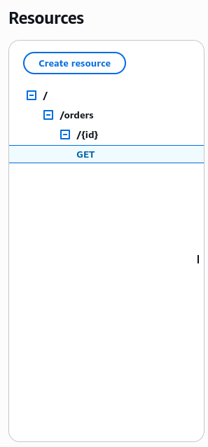
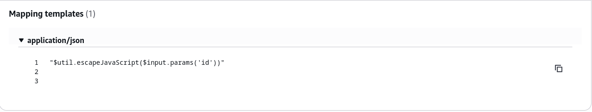
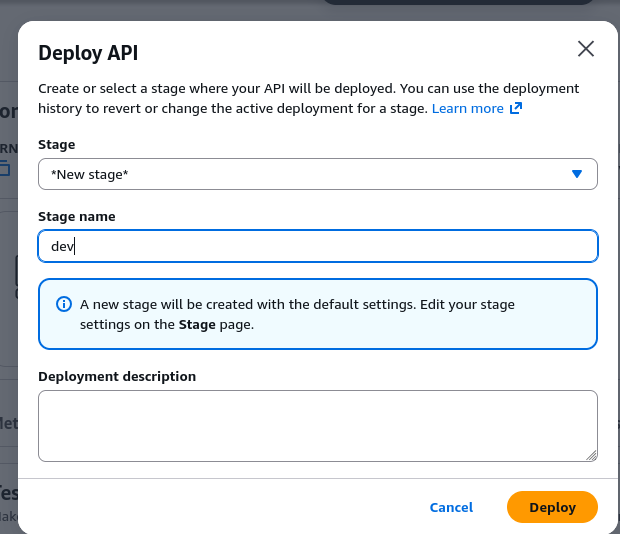

### Evidence

#### 1. The Lambda alone, with a JSON string as event

Before connecting API Gateway, the function was tested in the Lambda console with the event `"ORD-42"`. The event is only a JSON string, not an object. The runtime deserialized it into the `String id` parameter of `getOrder`:

```json
{ "id": "ORD-42", "customerId": "CUST-42", "product": "MacBook Air", "quantity": 1 }
```

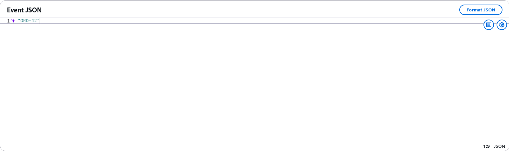
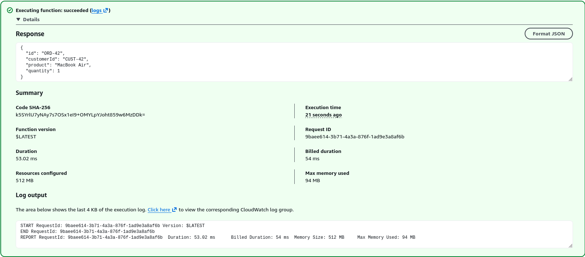

#### 2. API Gateway console test

Test of `GET /orders/{id}` with path parameter `id = ORD-42`: status **200**, body `{"id":"ORD-42","customerId":"CUST-42","product":"MacBook Air","quantity":1}`.

The execution log shows how the request was processed:

```
HTTP Method: GET, Resource Path: /orders/ORD-42
Method request path: {id=ORD-42}
Method request query string: {}
Method request headers: {}
Method request body before transformations:
Endpoint request URI: https://lambda.us-east-1.amazonaws.com/2015-03-31/functions/arn:aws:lambda:us-east-1:<account-id>:function:serverless-rest-api-get-order/invocations
```

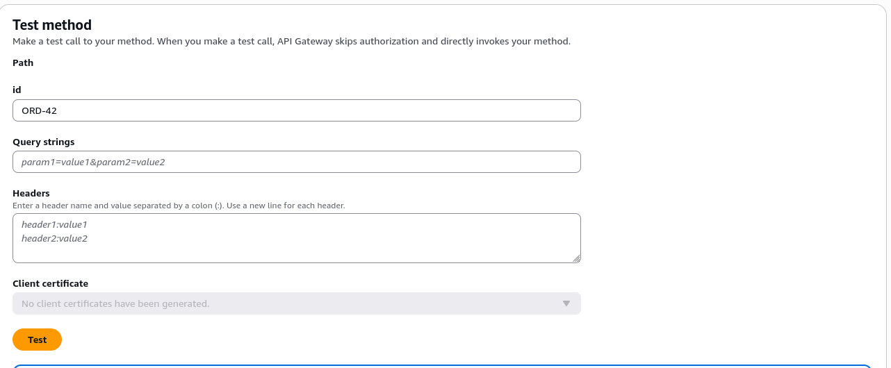
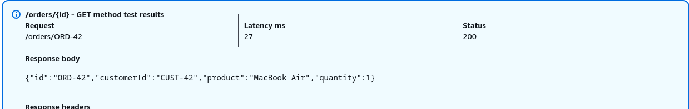

#### 3. Deployed API called over HTTP

| Request | Status | Body |
|---------|--------|------|
| `GET /dev/orders/ORD-42`  | 200 | `{"id":"ORD-42","customerId":"CUST-42","product":"MacBook Air","quantity":1}` |
| `GET /dev/orders/ORD-43`  | 200 | `{"id":"ORD-43","customerId":"CUST-42","product":"Magic Mouse","quantity":2}` |
| `GET /dev/orders/ORD-999` | **200** | `{"errorMessage":"Order with id ORD-999 was not Found","errorType":"co.edu.escuelaing.Exceptions","stackTrace":[...]}` |

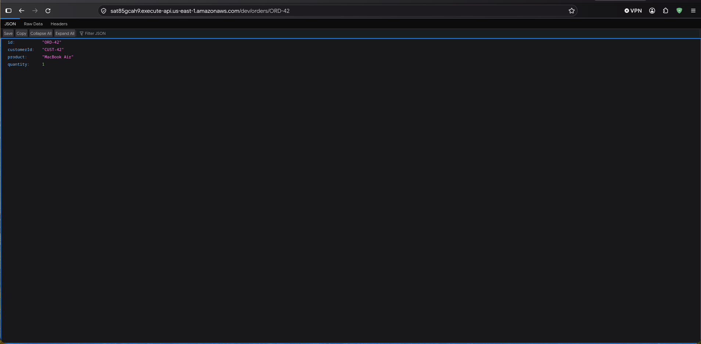
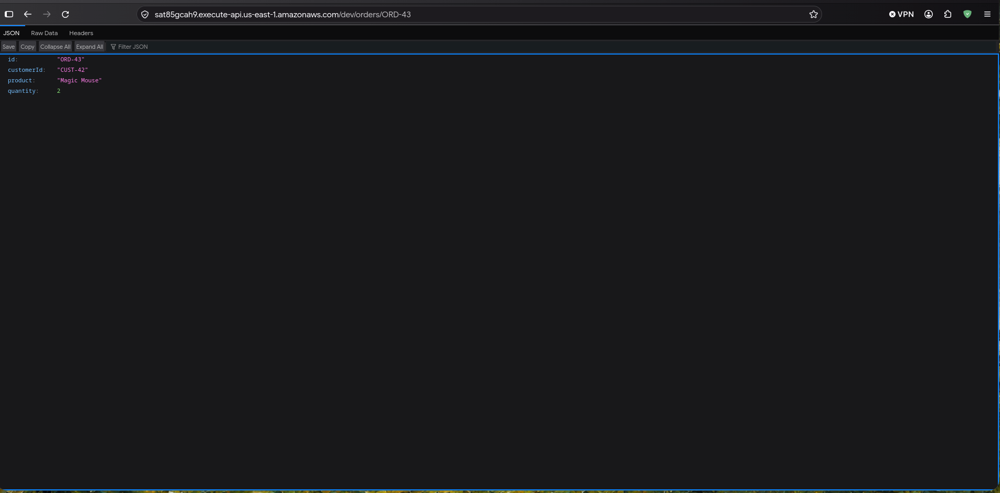
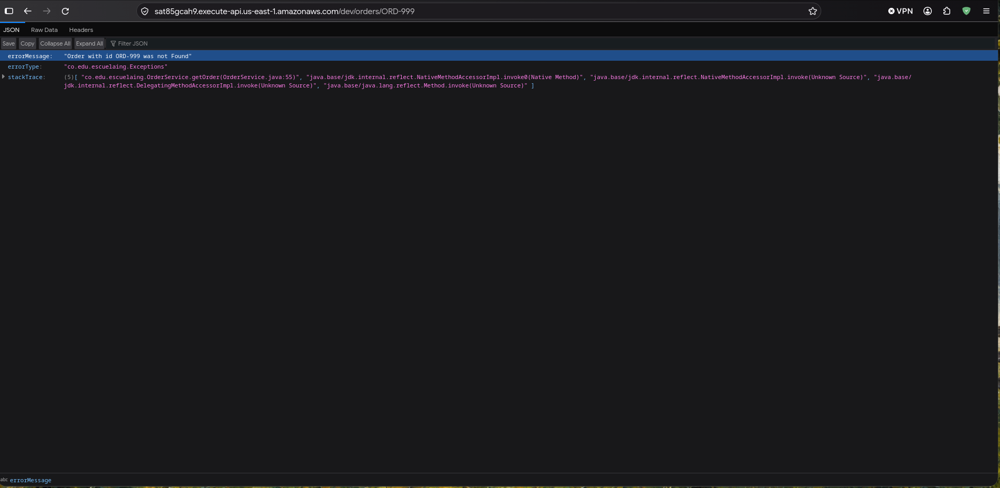

The status codes were checked with `curl -i`:

```
$ curl -i https://sat85gcah9.execute-api.us-east-1.amazonaws.com/dev/orders/ORD-42
HTTP/2 200
content-type: application/json

{"id":"ORD-42","customerId":"CUST-42","product":"MacBook Air","quantity":1}

$ curl -i https://sat85gcah9.execute-api.us-east-1.amazonaws.com/dev/orders/ORD-999
HTTP/2 200
content-type: application/json

{"errorMessage":"Order with id ORD-999 was not Found","errorType":"co.edu.escuelaing.Exceptions","stackTrace":["co.edu.escuelaing.OrderService.getOrder(OrderService.java:55)", ...]}
```

### Investigation: how does API Gateway extract `{id}` and transform the request?

*Investigated with an LLM, then checked against the deployed API.*

With a **custom (non-proxy) integration**, a REST API processes each request in four stages. Each stage is configured separately:

```
Method request  ->  Integration request  ->  Lambda  ->  Integration response  ->  Method response
```

**1. Method request: matching the route and capturing the path parameter.** The resource `/orders/{id}` declares a **path parameter** named `id`. When `GET /orders/ORD-42` arrives, API Gateway matches the URL against the resource tree and binds `id = ORD-42`. The log line `Method request path: {id=ORD-42}` shows exactly this. The value is only stored in the request context at this point; nothing has been sent to Lambda yet.

**2. Integration request: building the Lambda event with a mapping template.** With proxy integration disabled, API Gateway does not forward the HTTP request. Instead it **builds a new payload** from a *mapping template*, written in **VTL (Velocity Template Language)**. The template is chosen by the request's `Content-Type`. When the request has no `Content-Type`, which is always the case for a browser `GET`, API Gateway uses the `application/json` template.

Our template is:

```
"$util.escapeJavaScript($input.params('id'))"
```

- `$input.params('id')` returns the value of the request parameter `id`. It searches the **path**, then the **query string**, then the **headers**, in that order. A more explicit form is `$input.params().path.get('id')`.
- `$util.escapeJavaScript(...)` escapes characters such as `"` and `\`. Without it, an id containing a quote would produce invalid JSON.
- The surrounding quotes make the result a **JSON string**.

For `GET /orders/ORD-42` the template produces the payload `"ORD-42"`. The client sent no body at all (`Method request body before transformations:` is empty), so the body Lambda receives was **created entirely by API Gateway**.

**3. Lambda.** The Lambda Java runtime deserializes the event `"ORD-42"` into the `String` parameter of `getOrder`, exactly as in Part II. The Java code receives `ORD-42` and nothing else: no URL, no method, no headers.

**4. Integration response and method response: building the HTTP response.** The value returned by Lambda (`Order` serialized to JSON) goes through the integration response. No response template is configured, so it is passed through **unchanged** with the default status **200** and `Content-Type: application/json`.

**What a custom integration could also do.** The same mapping mechanism could build richer events, for example `{"id": "$input.params('id')", "requestedBy": "$context.identity.sourceIp"}`. It could map query strings and headers, or reshape the Lambda result in the integration response. All of that lives in API Gateway configuration, not in Java.

**Comparison with proxy integration.** With *Lambda proxy integration* enabled, there is no mapping template. API Gateway sends the **whole HTTP request** as a large JSON event (`httpMethod`, `path`, `pathParameters`, `queryStringParameters`, `headers`, `body`, `requestContext`, …). Lambda must then return an object with `statusCode`, `headers` and `body`. The Java code would have to understand HTTP, through an adapter class such as one that takes an `APIGatewayProxyRequestEvent`. With the custom integration, that responsibility stays in API Gateway and `OrderService` stays plain Java.

#### Verification against the deployed API

| Claim | Evidence |
|-------|----------|
| API Gateway extracts `{id}` from the path | Test log: `Method request path: {id=ORD-42}` for resource path `/orders/ORD-42`. |
| The Lambda event is built by the mapping template, not sent by the client | Test log: `Method request body before transformations:` is **empty**, yet Lambda received the id. |
| The event is a plain JSON string that maps to `String id` | `getOrder(String)` returned the right order. The same function tested directly with the event `"ORD-42"` returned the same result. If Lambda had received the full HTTP request (proxy), deserializing an object into a `String` would have failed. |
| Different path values reach the Java code | `ORD-42` and `ORD-43` returned their respective orders. |
| The Java application does not know about HTTP | `OrderService.getOrder` was not modified. It still takes only a `String`. |
| Without integration-response configuration, everything becomes `200` | `curl -i .../orders/ORD-999` returned **`HTTP/2 200`** with the Lambda error document as the body. |

### Problems found (solved in Part IV)

1. **A missing order returns `200 OK`, not `404 Not Found`.** With a custom integration, a Lambda error is not an HTTP error by itself. API Gateway needs an **integration response** whose *Lambda error regex* matches the `errorMessage` (e.g. `.*not Found.*`) and maps it to `404`, plus a response template that builds `{"error": "ORDER_NOT_FOUND", "message": "..."}`. Making error messages start with the error code (e.g. `ORDER_NOT_FOUND: Order ORD-999 does not exist`) would make those regexes more reliable.
2. **The response leaks internal details.** The body exposes `errorType` (a Java class name) and a `stackTrace` with source file names and line numbers. The error contract in section 1 says clients should receive only `error` and `message`.
3. **The error body does not follow the contract.** It uses Lambda's format (`errorMessage` / `errorType`) instead of `error` / `message`.

All three are API Gateway configuration problems, not Java problems: the Java code correctly reports *what* went wrong through the exception, and it is the integration layer's job to translate that into HTTP.

---

## 8. Part IV — API Gateway Mapping (non-proxy integration)

All three operations are exposed through the same REST API (`sat85gcah9`, stage `dev`) using **custom (non-proxy) integrations**. Each operation is a separate Lambda function running the **same JAR**; only the handler changes.

### Final architecture

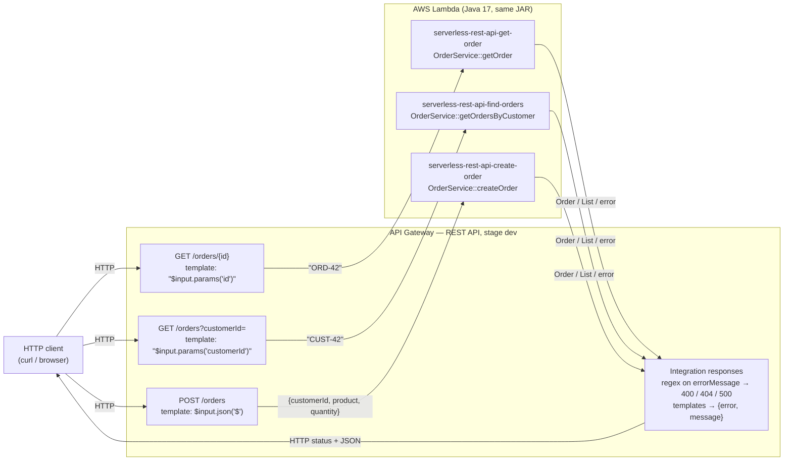

### Change in the Java application: error code in the message

With a non-proxy integration, API Gateway chooses the HTTP status by applying a regular expression (**Lambda error regex**) to the `errorMessage` of a failed invocation. It cannot see the exception's type field. To make that matching reliable, `Exceptions` now puts its error code in front of the message:

```java
super(type + ": " + message);   // e.g. "ORDER_NOT_FOUND: Order ORD-999 does not exist"
```

The not-found message was also aligned with the contract (`Order ORD-999 does not exist`). The unit test `shouldPrefixErrorMessageWithErrorCode` fixes this format, because API Gateway now depends on it. Nothing else changed: the Java code still knows nothing about HTTP.

### Configuration

| Method | Lambda (handler) | Integration request template (`application/json`) | Lambda receives |
|--------|------------------|---------------------------------------------------|-----------------|
| `GET /orders/{id}` | `serverless-rest-api-get-order` (`OrderService::getOrder`) | `"$util.escapeJavaScript($input.params('id'))"` | `"ORD-42"` |
| `GET /orders` (query `customerId`) | `serverless-rest-api-find-orders` (`OrderService::getOrdersByCustomer`) | `"$util.escapeJavaScript($input.params('customerId'))"` | `"CUST-42"` |
| `POST /orders` | `serverless-rest-api-create-order` (`OrderService::createOrder`) | `$input.json('$')` | `{"customerId":"CUST-42","product":"MacBook Air","quantity":1}` |

Design decision: the workshop suggests an event like `{"id": "ORD-42"}`. We send a bare JSON string instead, because `getOrder(String id)` and `getOrdersByCustomer(String customerId)` take a single `String`. A wrapper object would require a new Java class just to carry one field.

If `customerId` is not sent, `$input.params('customerId')` returns an empty string. Lambda receives `""`, and the Java validation rejects it with `INVALID_CUSTOMER`.

**Integration responses** (the same on every method where they apply):

| Lambda error regex | Method response | Response template |
|--------------------|-----------------|-------------------|
| *(default — successful invocation)* | `200` for the GETs, **`201`** for POST | none (pass-through) |
| `ORDER_NOT_FOUND:.*` | `404` (`GET /orders/{id}`) | error template |
| `INVALID_.*` | `400` | error template |
| `(?s)(?!ORDER_NOT_FOUND:\|INVALID_).+` | `500` | fixed `INTERNAL_ERROR` template |

In the table above the `|` of the 500 regex is escaped. The actual regex is `(?s)(?!ORDER_NOT_FOUND:|INVALID_).+`: any error that is *not* one of ours.

Error template (400 / 404). It splits `CODE: message` into the contract format and drops `errorType` and `stackTrace`:

```
#set($msg = $input.path('$.errorMessage'))
#set($sep = $msg.indexOf(': '))
#set($start = $sep + 2)
{
  "error": "$msg.substring(0, $sep)",
  "message": "$util.escapeJavaScript($msg.substring($start))"
}
```

500 template. It is a fixed message, so nothing internal is exposed:

```
{
  "error": "INTERNAL_ERROR",
  "message": "Unexpected error while processing the request"
}
```

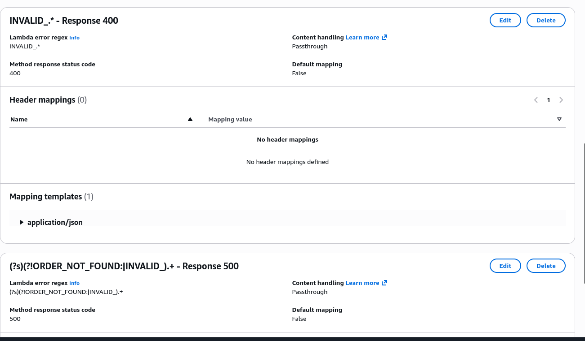

Each status (`201`, `400`, `404`, `500`) also had to be declared under **Method response**:

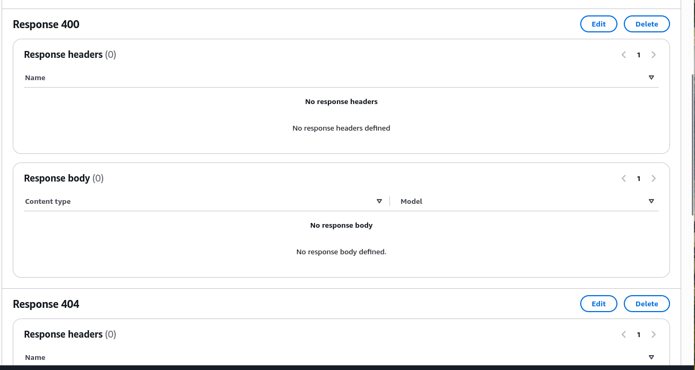
 Two configuration mistakes appeared during setup and are worth recording:

- After the `200` method response was deleted on `POST`, the default integration response still pointed to it. Every POST then failed with `Execution failed due to configuration error: Output mapping refers to an invalid method response: 200` → **500**, even though Lambda had created the order.
- The new methods worked in the console **Test**, but the public URL answered **`403 Missing Authentication Token`** until the API was **deployed again** to `dev`. A stage serves a snapshot of the configuration, not the current draft.

### Console tests

`GET /orders` with the query string `customerId=CUST-42` returned status 200 with the two orders of that customer:

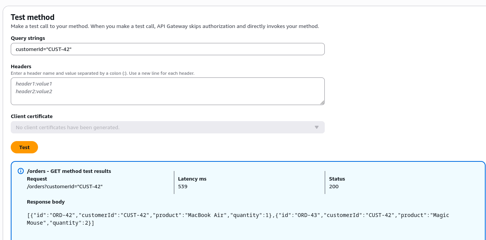

`POST /orders` with a JSON body returned **201**. The resource tree on the left shows the three methods (`GET /orders`, `POST /orders`, `GET /orders/{id}`). The id `ORD-8` reflects earlier test invocations in the same warm Lambda environment.

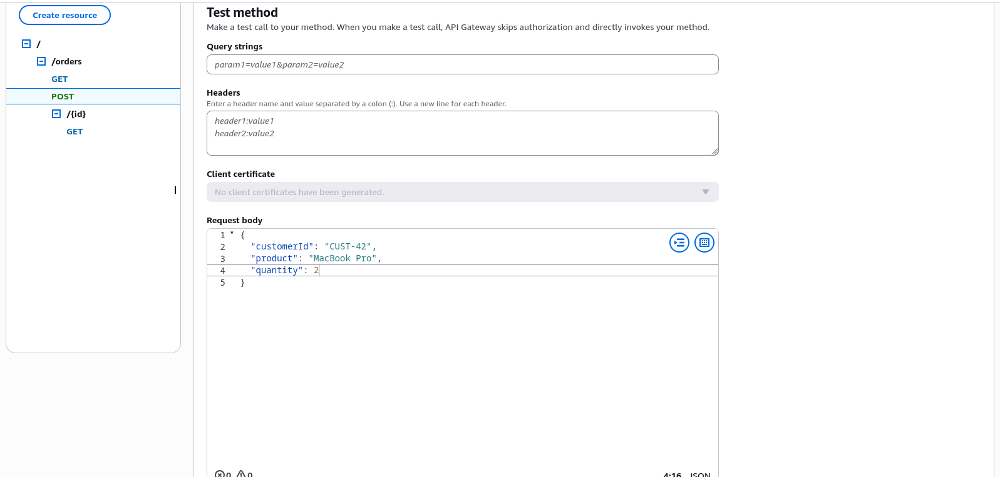
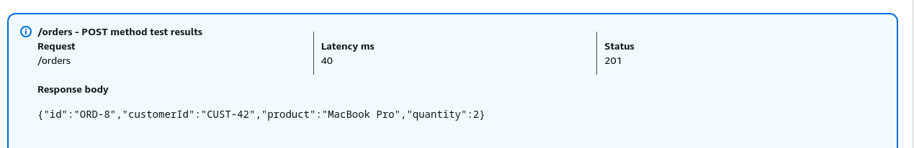

---

## 9. HTTP Semantics — test results

All requests were made with `curl -i` against `https://sat85gcah9.execute-api.us-east-1.amazonaws.com/dev`. Response headers are trimmed.

| # | Request | Expected | Got | Body |
|---|---------|----------|-----|------|
| 1 | `GET /orders/ORD-42` | 200 | **200** | `{"id":"ORD-42","customerId":"CUST-42","product":"MacBook Air","quantity":1}` |
| 2 | `GET /orders/ORD-999` | 404 | **404** | `{"error":"ORDER_NOT_FOUND","message":"Order ORD-999 does not exist"}` |
| 3 | `GET /orders?customerId=CUST-42` | 200 | **200** | `[{"id":"ORD-42",...,"product":"MacBook Air"...},{"id":"ORD-43",...,"product":"Magic Mouse"...}]` |
| 4 | `GET /orders?customerId=CUST-100` | 200 | **200** | `[]` |
| 5 | `GET /orders` (no `customerId`) | 400 | **400** | `{"error":"INVALID_CUSTOMER","message":"Customer id cannot be blank or null"}` |
| 6 | `POST /orders` valid body | 201 | **201** | `{"id":"ORD-4","customerId":"CUST-42","product":"MacBook Air","quantity":1}` |
| 7 | `POST /orders` with `"quantity":0` | 400 | **400** | `{"error":"INVALID_QUANTITY","message":"Quantity must be > 0"}` |
| 8 | `POST /orders` without `product` | 400 | **400** | `{"error":"INVALID_PRODUCT","message":"Product cannot be null or blank"}` |
| 9 | `POST /orders` with body `{malformed` | 400 | **400** | `{"message": "Could not process payload"}` ⚠️ |
| 10 | `POST /orders` with `"quantity":"two"` | 400 | **500** ⚠️ | `{"error":"INTERNAL_ERROR","message":"Unexpected error while processing the request"}` |
| 11 | `GET /customers` (route does not exist) | 404 | **403** ⚠️ | `{"message":"Missing Authentication Token"}` |
| 12 | `DELETE /orders/ORD-42` (method not configured) | 405 | **403** ⚠️ | `{"message":"Missing Authentication Token"}` |

Sample of the raw output:

```
$ curl -i $API/orders/ORD-999
HTTP/2 404
content-type: application/json

{
  "error": "ORDER_NOT_FOUND",
  "message": "Order ORD-999 does not exist"
}

$ curl -i -X POST $API/orders -H "Content-Type: application/json" \
       -d '{"customerId":"CUST-42","product":"MacBook Air","quantity":1}'
HTTP/2 201
content-type: application/json

{"id":"ORD-4","customerId":"CUST-42","product":"MacBook Air","quantity":1}

$ curl -i -X POST $API/orders -H "Content-Type: application/json" -d '{malformed'
HTTP/2 400
content-type: application/json
x-amzn-errortype: BadRequestException

{"message": "Could not process payload"}
```

Screenshots of the full `curl -i` run (cases 1–9):

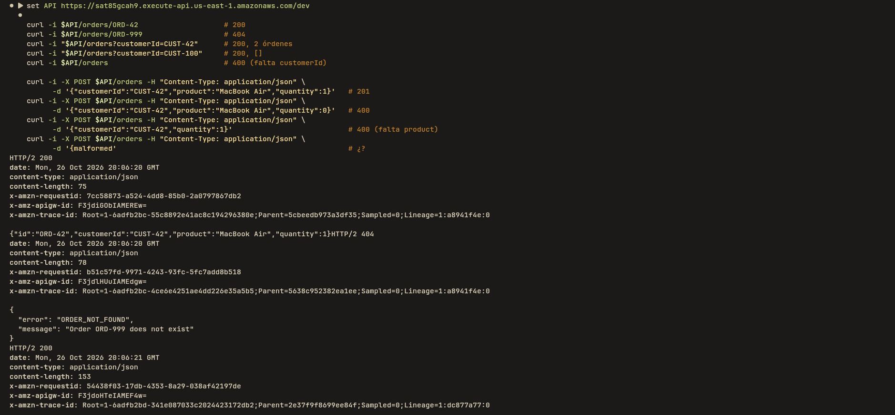
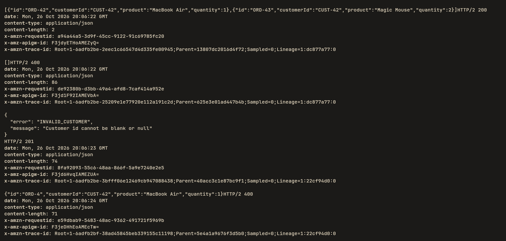
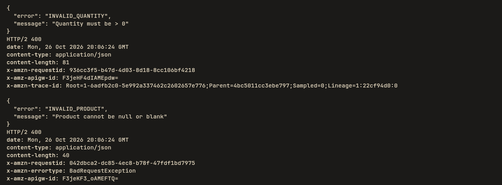

### Observations

- **Cases 1–8 behave as the contract requires.** Correct status codes, error bodies in the `{error, message}` format, no stack traces. The three problems found in Part III are solved.
- **Case 6 returned `ORD-4`.** The create function now uses the JAR with the three sample orders, so the generated id is `size + 1 = 4`. This confirms that each Lambda function has its own in-memory list: the order created here is **not** visible to `GET /orders/ORD-4`, which runs in a different function.
- **Case 9: the error comes from API Gateway itself.** `$input.json('$')` could not parse the body, so API Gateway rejected it (`x-amzn-errortype: BadRequestException`) and **never invoked Lambda**: there is no `x-amzn-trace-id` header in this response. The status is right (400), but the body does not follow our error format, because our integration-response templates only apply to responses that come from Lambda.
- **Case 10: a client error reported as 500.** The JSON is valid, so API Gateway forwards it. The **Lambda Java runtime** then fails to deserialize `"two"` into `int quantity` *before our code runs*. Its error message has no `INVALID_` prefix, so it falls into the 500 catch-all. The response is safe, since nothing internal is exposed, but semantically wrong.
- **Cases 11–12: unknown routes and methods give `403 Missing Authentication Token`.** This is API Gateway's default for any route or method that does not exist. The correct answers would be `404 Not Found` and `405 Method Not Allowed`.
- **The `Location` header for `201` is not configured yet.** It could be added in the `201` integration response with `#set($context.responseOverride.header.Location = "/orders/$input.path('$.id')")`.

Cases 9–12 could be fixed in API Gateway without touching Java. **Gateway Responses** customize the errors API Gateway generates itself (e.g. `DEFAULT_4XX`, `MISSING_AUTHENTICATION_TOKEN` → 404 with our format). A **request model + request validator** (a JSON Schema requiring `customerId`, `product` and an integer `quantity > 0`) would reject case 10 with a 400 before Lambda runs.

---

## 10. Checkpoint 3 — Who is responsible for what?

### What API Gateway is currently responsible for

| Responsibility | How it is done here |
|----------------|---------------------|
| **Routing** | The resource tree (`/orders`, `/orders/{id}`) plus the HTTP method decides which of the three Lambda functions is invoked. |
| **Rejecting unknown routes and methods** | Anything not configured is answered by API Gateway (`403 Missing Authentication Token`) without invoking Lambda. |
| **Extracting path parameters** | `{id}` in `/orders/{id}` → `$input.params('id')`. |
| **Extracting query parameters** | `customerId` → `$input.params('customerId')`. |
| **Parsing the request body** | `$input.json('$')` parses the body. Malformed JSON is rejected with 400 before Lambda. |
| **Transforming requests** | VTL mapping templates build the Lambda event: a bare string for the GETs, the body for POST. Values are escaped with `$util.escapeJavaScript`. |
| **Invoking Lambda** | API Gateway calls Lambda with its own permission. The client never talks to Lambda. |
| **Choosing status codes** | Default response → 200 or 201. Lambda errors → 400, 404 or 500 depending on the regex. |
| **Mapping errors** | Regexes on `errorMessage` classify the error. Each class has its own method response. |
| **Transforming responses** | Templates turn the Lambda error document (`errorMessage`, `errorType`, `stackTrace`) into `{error, message}`, and **hide** internal details. |
| **Response headers** | `Content-Type: application/json` (and, potentially, `Location`). |
| **Deployment / versioning of the HTTP interface** | Stages (`dev`) serve a deployed snapshot of all the above. |

**What it is *not* responsible for:**
- **Business rules:** validation, id generation, searching, all in `OrderService`/`OrderRequest`.
- **JSON ↔ Java conversion:** done by the Lambda Java runtime.
- **Storage:** in-memory, inside each Lambda environment.

Our Java code still has **zero knowledge of HTTP**: it receives a `String` or an `OrderRequest` and returns an `Order`, a `List<Order>`, or throws `Exceptions`.

### Advantages of this distribution

1. **The application stays plain Java.** `OrderService` is the same class used by the JUnit tests in Part I. It has no AWS or HTTP dependency, the JAR is thin, and the business logic is tested in milliseconds without the cloud.
2. **Clear separation of concerns.** The HTTP contract (URLs, status codes, error format) lives in the HTTP layer; the business rules live in Java. Each can change independently. For example, renaming `/orders` to `/v1/orders` needs no new JAR.
3. **Bad requests are rejected early and cheaply.** Unknown routes and malformed JSON are answered by API Gateway without invoking (and paying for) a Lambda.
4. **Centralized protection of internal details.** Whatever the Java code throws, the templates guarantee clients only ever see `{error, message}`. Stack traces and class names cannot leak through a forgotten `catch`.
5. **Minimal inputs per function.** Each Lambda receives exactly what it needs (`"ORD-42"`), not a large HTTP event, so the functions are simpler and their inputs are easy to reproduce in the Lambda console.
6. **Declarative.** Routing and mapping are configuration, not code. API Gateway can also export it as OpenAPI.

### Disadvantages of this distribution

1. **The behavior is split across two places, and one of them is not in the repository.** Status codes and error formats are defined in console configuration. They are not in git, not code-reviewed, and not covered by `mvn test`. To understand what `GET /orders/ORD-999` returns, you must read Java *and* click through the console.
2. **The HTTP layer cannot be tested locally.** Both configuration mistakes we made (the orphan `200` response and the missing deploy) were only found by deploying and calling the real API.
3. **Hidden coupling through strings.** The HTTP status depends on the *text* of `errorMessage` matching a regex. If someone renames `INVALID_QUANTITY` or changes the message format, the compiler and the domain tests stay green, but the API silently returns 500 instead of 400. Only the `shouldPrefixErrorMessageWithErrorCode` test protects this contract, and only partially.
4. **VTL is an extra, niche language.** The mapping templates contain logic (`indexOf`, `substring`, escaping) written in a language with poor tooling and no tests. A bug there only shows up at runtime.
5. **Duplication.** The same error templates and regexes are repeated on every method. Adding an endpoint means repeating the whole configuration.
6. **Errors from three different layers.** Clients can receive errors from:
   - our Java code (`{error, message}`, correct);
   - API Gateway itself (`{"message": "Could not process payload"}`, `403 Missing Authentication Token`);
   - the Lambda runtime (deserialization failure → 500).

   Each one needs its own fix (integration responses, Gateway Responses, request models) to make the API consistent.
7. **Vendor lock-in.** Mapping templates and integration responses exist only in API Gateway **REST APIs**. HTTP APIs don't support them, and no other platform understands them. Moving the API means rewriting the HTTP layer from scratch.
8. **One function per operation.** Three Lambda functions deploy the same JAR, each with its own cold starts and its own in-memory state. Case 6 shows the state problem: an order created through `POST` cannot be read through `GET`.

### Conclusion

This design puts **all HTTP knowledge in API Gateway** and **all business knowledge in Java**. That keeps the Java code clean, portable and easy to test. The price is a significant amount of untested, unversioned, platform-specific logic in API Gateway configuration, coupled to the Java code through the text of error messages. It works well for a small API with few endpoints. As the API grows, the cost of maintaining mapping templates per method grows with it. Lambda **proxy integration** makes the opposite trade-off: it moves those responsibilities into the code.

---

## 11. Part V — Lambda Proxy Integration

A **second, independent API** was created so that both architectures stay deployed and can be compared side by side.

| | Architecture A (Parts III–IV) | Architecture B (Part V) |
|--|--|--|
| REST API | `sat85gcah9` | `orders-api-proxy` (`0lx1iz642k`) |
| Base URL | `https://sat85gcah9.execute-api.us-east-1.amazonaws.com/dev` | `https://0lx1iz642k.execute-api.us-east-1.amazonaws.com/dev` |
| Resources | `/orders` (GET, POST), `/orders/{id}` (GET) | `/orders` (**ANY**), `/orders/{id}` (**ANY**) |
| Integration | Custom (non-proxy), mapping templates | **Lambda proxy integration** |
| Lambda functions | 3 (one per operation) | **1**: `serverless-rest-api-orders-proxy` |
| Handler | `OrderService::getOrder`, `::getOrdersByCustomer`, `::createOrder` | `co.edu.escuelaing.http.OrdersHandler::handleRequest` |
| Integration / method responses | 1 default + 3 error responses per method, with VTL templates | None |

The methods use `ANY`, so that every HTTP method reaches Lambda and the adapter itself decides between `405 Method Not Allowed` and a real operation.

### The proxy event

With proxy integration, API Gateway does not transform anything. It sends Lambda **the whole HTTP request** as a JSON event, and the Java runtime maps it to `APIGatewayProxyRequestEvent` (from `aws-lambda-java-events`). Where each piece of information appears:

| Information | Field in the event | Example (`GET /dev/orders/ORD-42`) | Example (`GET /dev/orders?customerId=CUST-42`) |
|---|---|---|---|
| HTTP method | `httpMethod` (also `requestContext.httpMethod`) | `"GET"` | `"GET"` |
| Path | `path`, without the stage. `requestContext.path` includes the stage | `"/orders/ORD-42"`. `requestContext.path`: `"/dev/orders/ORD-42"` | `"/orders"` |
| Matched resource | `resource` (the template, not the value) | `"/orders/{id}"` | `"/orders"` |
| Path parameters | `pathParameters` | `{"id": "ORD-42"}` | `null` |
| Query parameters | `queryStringParameters` (and `multiValueQueryStringParameters`) | `null` | `{"customerId": "CUST-42"}` |
| Headers | `headers` (and `multiValueHeaders`) | `{"Accept": "*/*", "Host": "...", "User-Agent": "curl/..."}` | same |
| Request body | `body`, **as a string**, not as JSON. `isBase64Encoded` says if it is encoded | `null` | `null`. For POST: `"{\"customerId\":\"CUST-42\",...}"` |
| Stage, request id, caller IP… | `requestContext` (`stage`, `requestId`, `identity.sourceIp`, …) | `"stage": "dev"` | same |

#### Captured example event

A real event, captured from the API Gateway console **Test** of `/orders/{id}` → `ANY`, is saved in [`events/proxy-get-order-test-invoke.json`](events/proxy-get-order-test-invoke.json). It is the `Endpoint request body after transformations` log line. The account id, the IAM user/role identifiers and the access key id were redacted before committing it.

```json
{
  "resource": "/orders/{id}",
  "path": "/orders/id=ORD-42",
  "httpMethod": "GET",
  "headers": null,
  "multiValueHeaders": null,
  "queryStringParameters": null,
  "multiValueQueryStringParameters": null,
  "pathParameters": { "id": "id=ORD-42" },
  "stageVariables": null,
  "requestContext": {
    "resourcePath": "/orders/{id}",
    "httpMethod": "GET",
    "path": "/orders/{id}",
    "stage": "test-invoke-stage",
    "requestId": "961a6303-564c-4f30-be5a-9a41052b3656",
    "identity": { "sourceIp": "test-invoke-source-ip", "...": "..." },
    "apiId": "0lx1iz642k",
    "...": "..."
  },
  "body": null,
  "isBase64Encoded": false
}
```

What this event shows:
- **The id field of the console test was filled with `id=ORD-42` instead of `ORD-42`.** API Gateway does not interpret path values; it copies the raw segment into `pathParameters.id`. The adapter passed it unchanged to `getOrder`, which correctly answered `404 ORDER_NOT_FOUND: Order id=ORD-42 does not exist`.
- **A console test is not identical to a real request.** `headers` is `null` (the console sends none), the stage is `test-invoke-stage`, and `requestContext.path` holds the resource *template* (`/orders/{id}`). In a real request through the `dev` URL, `requestContext.path` holds the actual path with the stage. This was confirmed by the `Location: /dev/orders/ORD-4` header built from it (see section 13).

Absent sections arrive as `null`, not as empty maps. For example, `queryStringParameters` is `null` when there is no query string. The adapter has to handle that.

The response must follow the same proxy contract. Lambda returns `{statusCode, headers, body}`, with `body` again a **string**, and API Gateway turns it into the real HTTP response.

### What happens if proxy integration is not enabled

On the first deployment, the **Lambda proxy integration** switch was accidentally left off on both `ANY` methods. Every request then returned:

```
HTTP/2 200
{"statusCode":404,"headers":{"Content-Type":"application/json"},"body":"{\"error\":\"NOT_FOUND\",\"message\":\"Route null does not exist\"}"}
```

Both halves of the proxy contract were broken:
- **Request:** API Gateway forwarded only the (empty) request body, so the adapter received an event with no `httpMethod` or `path`. Hence "Route **null**".
- **Response:** API Gateway did not interpret the `{statusCode, headers, body}` object. It returned it as plain JSON inside an HTTP 200.

This shows that the adapter and the proxy integration form **one contract**: the same Lambda behaves completely differently depending on one checkbox in the console.

---

## 12. HTTP Adapter

```
API Gateway (proxy)
      |
      |  APIGatewayProxyRequestEvent
      v
OrdersHandler                (co.edu.escuelaing.http — knows HTTP and AWS)
  - routing by method + path
  - pathParameters / queryStringParameters / body (Jackson)
  - exception → status code + {error, message}
  - headers (Content-Type, Location)
      |
      |  String id / String customerId / OrderRequest
      v
OrderService                 (co.edu.escuelaing — plain Java, unchanged)
      |
      v
Order / List<Order> / Exceptions
```

`OrdersHandler` implements `RequestHandler<APIGatewayProxyRequestEvent, APIGatewayProxyResponseEvent>`. It is the **only** class that imports AWS or Jackson; `Order`, `OrderRequest`, `OrderService` and `Exceptions` import neither.

| Request | Adapter does | Calls |
|---|---|---|
| `POST /orders` | parses `body` with Jackson into `OrderRequest` | `createOrder(request)` → **201** + `Location` |
| `GET /orders` | reads `queryStringParameters.customerId` (null-safe) | `getOrdersByCustomer(customerId)` → **200** |
| `GET /orders/{id}` | reads `pathParameters.id` | `getOrder(id)` → **200** |
| `DELETE /orders/{id}` (added in section 17) | reads `pathParameters.id` | `deleteOrder(id)` → **204**, no body |
| other method on a known path | — | **405** `METHOD_NOT_ALLOWED` |
| unknown path (reaching the Lambda) | — | **404** `NOT_FOUND` |

Error translation (in one `switch`):

| Thrown | HTTP | `error` |
|---|---|---|
| `Exceptions` with `ORDER_NOT_FOUND` | 404 | `ORDER_NOT_FOUND` |
| `Exceptions` with `INVALID_*` | 400 | the same code (`INVALID_QUANTITY`, …) |
| Jackson `JsonProcessingException` (malformed JSON, wrong field type) | 400 | `INVALID_REQUEST` |
| any other `RuntimeException` | 500 | `INTERNAL_ERROR` (details only in the CloudWatch log) |

Changes needed outside the adapter:
- `Exceptions.getDetail()` returns the message **without** the `CODE: ` prefix. The prefix is kept because Architecture A still depends on it.
- `pom.xml` now includes `aws-lambda-java-core`, `aws-lambda-java-events` and `jackson-databind`, plus the **maven-shade-plugin**. Lambda needs those libraries inside the JAR, so it grew from ~12 KB to ~3.4 MB (a "fat" JAR, as anticipated in Checkpoint 1).

Because the handler is a normal Java class, the whole HTTP layer is tested **locally**. `OrdersHandlerTest` builds `APIGatewayProxyRequestEvent` objects in memory and checks status codes, headers and bodies, with no AWS needed. At the end of Part V there were 14 HTTP tests (31 in total); after section 17 there are 19 (42 in total).

---

## 13. HTTP Responses — test results (Architecture B)

All requests made with `curl -i` against `https://0lx1iz642k.execute-api.us-east-1.amazonaws.com/dev`.

| # | Request | Status | Body / headers |
|---|---------|--------|----------------|
| 1 | `GET /orders/ORD-42` | **200** | `{"id":"ORD-42","customerId":"CUST-42","product":"MacBook Air","quantity":1}` |
| 2 | `GET /orders/ORD-999` | **404** | `{"error":"ORDER_NOT_FOUND","message":"Order ORD-999 does not exist"}` |
| 3 | `GET /orders?customerId=CUST-42` | **200** | `[{"id":"ORD-42",...},{"id":"ORD-43",...}]` |
| 4 | `GET /orders?customerId=CUST-100` | **200** | `[]` |
| 5 | `GET /orders` (no `customerId`) | **400** | `{"error":"INVALID_CUSTOMER","message":"Customer id cannot be blank or null"}` |
| 6 | `POST /orders` valid | **201** | `location: /orders/ORD-4`, `{"id":"ORD-4","customerId":"CUST-42","product":"MacBook Air","quantity":1}` |
| 7 | `POST /orders` `"quantity":0` | **400** | `{"error":"INVALID_QUANTITY","message":"Quantity must be > 0"}` |
| 8 | `POST /orders` without `product` | **400** | `{"error":"INVALID_PRODUCT","message":"Product cannot be null or blank"}` |
| 9 | `POST /orders` `{malformed` | **400** | `{"error":"INVALID_REQUEST","message":"Request body is not valid JSON for an order"}` |
| 10 | `POST /orders` `"quantity":"two"` | **400** | `{"error":"INVALID_REQUEST","message":"Request body is not valid JSON for an order"}` |
| 11 | `POST /orders` (`CUST-9`, Keyboard) then `GET /orders/ORD-5` | **201** then **200** | `location: /orders/ORD-5`, then the same order |
| 12 | `DELETE /orders/ORD-42` | **405** | `{"error":"METHOD_NOT_ALLOWED","message":"DELETE is not allowed on /orders/{id}"}`. This was before DELETE existed; it now returns 204 (section 17) |
| 13 | `PUT /orders` | **405** | `{"error":"METHOD_NOT_ALLOWED","message":"PUT is not allowed on /orders"}` |
| 14 | `GET /customers` | **403** | `{"message":"Missing Authentication Token"}` (from API Gateway) |

```
$ curl -i -X POST $API/orders -H "Content-Type: application/json" \
       -d '{"customerId":"CUST-9","product":"Keyboard","quantity":2}'
HTTP/2 201
content-type: application/json
location: /orders/ORD-5

{"id":"ORD-5","customerId":"CUST-9","product":"Keyboard","quantity":2}

$ curl -i $API/orders/ORD-5
HTTP/2 200
content-type: application/json

{"id":"ORD-5","customerId":"CUST-9","product":"Keyboard","quantity":2}
```

### Observations

- **Cases 9, 10, 12 and 13 now follow the contract.** In Architecture A they returned API Gateway's `{"message": "Could not process payload"}`, a **500** for `"two"`, and `403` for unsupported methods. Here they reach Java, where they are handled like any other error.
- **Case 11: create-then-read works.** With one Lambda for all operations, `POST` and `GET` share the same `OrderService` instance, as long as both requests reach the same warm execution environment. In Architecture A this was impossible, because each operation was a different function. The data is still **not persistent**: a cold start or a second concurrent environment would not see `ORD-5`.
- **Case 14: unknown routes are still answered by API Gateway**, because `/customers` is not a configured resource and never reaches the Lambda. The adapter's own `404 NOT_FOUND` only applies to paths routed to it. A `/{proxy+}` resource would send *everything* to the adapter.
- **Deployment propagation:** right after redeploying with proxy enabled, two requests (cases 4 and 8) still got the old non-proxy response for a few seconds. Repeated requests were all correct.

### Should `POST` return a `Location` header?

Yes. RFC 9110 says a `201 Created` response should identify the new resource, and `Location` is the standard way to do it. The client gets the order's URL without having to know how URLs are built. With the proxy adapter it is one line of Java; in Architecture A it required a `$context.responseOverride` VTL expression that we did not configure.

The first deployed version returned `location: /orders/ORD-5`. That is a root-relative path **without the stage**, so a client resolving it against `https://0lx1iz642k.execute-api.us-east-1.amazonaws.com/dev/orders` would end up at `https://…/orders/ORD-5`, which does not exist. The adapter was fixed to build `Location` from `requestContext.path`, which contains the path exactly as the client used it (`/dev/orders`). The result is `/dev/orders/ORD-5`, and it still works behind a custom domain without a stage. This is covered by the test `locationShouldIncludeTheStageWhenApiGatewayProvidesIt`. After redeploying the JAR:

```
$ curl -i -X POST $API/orders -H "Content-Type: application/json" \
       -d '{"customerId":"CUST-7","product":"Monitor","quantity":1}'
HTTP/2 201
location: /dev/orders/ORD-4

{"id":"ORD-4","customerId":"CUST-7","product":"Monitor","quantity":1}
```

The id is `ORD-4` again because uploading new code started a fresh execution environment, which is the in-memory state behavior seen in Part II.

---

## 14. Comparing the two architectures

| | **A — API Gateway transformation** | **B — Proxy + HTTP adapter** |
|---|---|---|
| Lambda functions | 3 | 1 |
| API Gateway objects configured | 3 methods, 3 request templates, ~9 integration responses with regex + VTL, ~10 method responses | 2 `ANY` methods with a checkbox |
| Java infrastructure code | 0 lines (handlers point at `OrderService` directly) | `OrdersHandler` (~150 lines) + 3 dependencies + shade plugin |
| Where status codes live | regexes on `errorMessage` + method responses, in the console | one `switch` and `json(201, …)` calls, in Java |
| HTTP behavior tested by `mvn test` | none | 14 tests (19 after section 17) |
| Errors in the contract format | only those from Lambda; API Gateway's own errors and runtime deserialization errors do not match | all requests that reach Lambda |
| JAR | ~12 KB, no dependencies | ~3.4 MB fat JAR |

**Which approach required more API Gateway configuration?**
**A**, by far. Every method needed its own request template, its own method responses (200/201, 400, 404, 500) and its own integration responses, each with a regex and a VTL template. Several of those had to be repeated. B needed two `ANY` methods and the proxy checkbox; nothing else.

**Which approach required more Java infrastructure code?**
**B.** A had zero infrastructure code: Lambda called `OrderService` methods directly. B added `OrdersHandler` (routing, parameter extraction, JSON parsing, error translation, headers), the AWS events and Jackson dependencies, and the shade plugin.

**Which was easier to test locally?**
**B.** Its whole HTTP behavior (status codes, headers, error bodies, routing, malformed JSON) is covered by `OrdersHandlerTest` and runs in under a second with `mvn test`. In A, only the business logic could be tested locally. Every HTTP mistake (the orphan `200` method response, the forgotten deploy, the `"two"` → 500 case) was only found after deploying and calling the real API.

**Where are HTTP status codes defined in each approach?**
- **A:** in API Gateway configuration. The *default integration response* gives 200/201, and *Lambda error regexes* on `errorMessage` map errors to 400/404/500. The Java code only influences them indirectly, through the text prefix of its exception messages.
- **B:** in Java, in `OrdersHandler`. `statusFor(...)` maps the exception type, and the success paths call `json(200, …)` / `json(201, …)`. API Gateway passes `statusCode` through unchanged.

**What happens if the API grows from 3 operations to 30?**
- **A** grows linearly in console configuration: about 30 request templates, 90–120 integration responses with regex and VTL, and potentially 30 Lambda functions with 30 deployments of the same JAR, each with its own cold start. All of it is untested and not in git unless exported as OpenAPI or written in infrastructure-as-code. The coupling through message prefixes would also have to be kept consistent across all of them.
- **B** grows in Java: more routes in the adapter. With 30 routes, the hand-written `if`/`switch` router would become a problem itself; at that point you would split it into several handlers per resource or use a small routing library. But that code is versioned, reviewed, refactorable and unit-tested. API Gateway can stay at a few `ANY` resources, or a single `/{proxy+}`.

**Which approach makes the Java business logic cleaner?**
Both leave the business logic **equally clean**. `OrderService`, `Order` and `OrderRequest` are identical in both and know nothing about HTTP. The difference is elsewhere:
- **A** made the domain *slightly* aware of its transport: the `CODE: message` format exists only so that API Gateway regexes can parse it.
- **B** keeps that concern in the adapter, which uses the exception's enum type directly.

So B's business logic is marginally cleaner. The price is that the *project* now contains infrastructure code, isolated in the `http` package.

**Which approach would be easier for another developer to understand?**
**B**, for most developers. The full request → response path can be read top to bottom in one Java file, with tests documenting every case. In A, the behavior of a single request is spread across a resource tree, a VTL request template, a Java method, a list of regexes and a VTL response template, all in different console screens. A newcomer needs to know API Gateway's mapping model just to find out why a request returns 404. A is easier only for someone who already thinks in API Gateway terms and wants to see the HTTP contract without reading code.

**Which approach would you choose for a larger system? Why?**
**B (proxy + thin adapter)**, keeping the separation we built: an `http` adapter layer around a plain-Java core.
- The HTTP behavior is code. It is versioned, reviewed, unit-tested, and can be refactored as the API grows.
- Errors are consistent, because everything that reaches Lambda goes through one translation point. A's errors came from three different layers.
- It is portable. Only the adapter depends on API Gateway's event format; moving to an HTTP API, an ALB or a container means writing a new adapter, not rewriting VTL.
- Fewer functions and deployments: one artifact per bounded context instead of one per operation.

That choice still keeps some of A's strengths, by assigning API Gateway what it does best at the edge: routing to the right function, authentication, throttling, and optionally request validation. What should not live there is business-dependent behavior written in VTL. A remains a reasonable option for very small, stable APIs, or when API Gateway integrates directly with other AWS services without any Lambda. In those cases mapping templates are the only place the transformation can live.

---

## 15. AI-Assisted Development

This project was developed with **Claude Code** (Claude Opus) running as a coding agent in VS Code, with access to the repository, the terminal and the deployed API URLs, but **not** to the AWS console or credentials.

### How the assistant was used

| Phase | Developer | Assistant |
|---|---|---|
| API contract and README questions | Reviewed and accepted the design | Drafted the contract, error format and answers |
| Part I — business logic | **Wrote** `Order`, `OrderRequest`, `OrderService`, `Exceptions` | Reviewed them over several rounds and pointed out bugs; the developer fixed them (see below) |
| Unit tests | Requested them | Wrote `OrderServiceTest` and the Maven/JUnit setup |
| Lambda + API Gateway (Parts II–IV) | **Configured everything in the AWS console**, took the screenshots, ran the tests | Gave step-by-step instructions, diagnosed errors from logs and `curl` output, verified the public endpoints with `curl`, documented the results |
| Part V — proxy adapter | Configured the second API and Lambda | Designed and implemented `OrdersHandler` and its tests, and found and fixed its `Location` bug |
| Security hygiene | **Cropped screenshots** containing the AWS account id | Flagged account ids, emails and session tokens in screenshots and logs, and redacted the saved event |

Bugs the assistant found in the hand-written Part I code, which the developer then fixed:
- `String` comparison with `==`;
- `getOrder` throwing on the first non-matching order;
- `getOrdersByCustomer` returning `null` and adding to the list it was iterating (`ConcurrentModificationException`);
- `"ORD-" + size + 1` concatenating strings (`ORD-01`, `ORD-11`…);
- `id.isBlank() || id == null` throwing `NullPointerException`;
- `createOrder` never storing the order;
- `quantity < 0` accepting 0.

### Prompt used for the proxy-integration part (improved)

```
I have a Java 17 Orders API. The business logic (OrderService, Order, OrderRequest,
Exceptions with an enum of error types) is plain Java with no AWS dependencies and
17 JUnit tests. It is currently exposed through API Gateway REST with non-proxy
integrations: 3 Lambda functions whose handlers point directly at OrderService
methods, VTL mapping templates, and Lambda-error-regex integration responses.

I want a second, independent API using Lambda proxy integration for:
  POST /orders, GET /orders/{id}, GET /orders?customerId=...

Constraints:
- OrderService/Order/OrderRequest must not import AWS or JSON-library classes.
- Errors must follow {"error": CODE, "message": text}; 404 for ORDER_NOT_FOUND,
  400 for invalid input including malformed JSON, 500 without internal details.
- POST returns 201 and decide whether/how to send Location.
- The existing non-proxy API must keep working (it relies on the "CODE: message"
  exception message format).
- The HTTP layer must be unit-testable without AWS.

Before generating code:
1. propose the architecture (how many Lambdas, where routing lives);
2. list existing files that must change and why;
3. list new classes and dependencies (and the impact on the JAR);
4. state exactly where each HTTP responsibility will live;
5. list the trade-offs of your proposal and one alternative.
Do not implement until I approve.
```

The improvements over the workshop's example prompt:
- it states the **current** architecture and the constraints coming from it (Architecture A must keep working);
- it defines the error contract up front;
- it asks for dependencies and their impact, plus trade-offs and an alternative, so the agent's choices can be evaluated instead of just accepted.

---

## 16. Criticizing the agent

Four non-trivial decisions proposed by the assistant during this workshop.

### Decision 1 — One Lambda per operation in Architecture A

**Decision made by the agent:** create a separate function for each operation (`serverless-rest-api-get-order`, `-find-orders`, `-create-order`), each with a handler pointing directly at an `OrderService` method.

**Why do you think it proposed this?** It is the shortest path that satisfies "do not redesign the application". A Lambda handler can be any public method, so each function needs zero adapter code, and each mapping template only has to produce the one argument that method takes.

**Do you agree with it?** Partially. It kept the Java untouched and made Part II–IV simple. But it had a real cost, visible in the tests: three deployments of the same JAR, three sets of cold starts, and **no shared state**. An order created with `POST` could never be read with `GET` (`ORD-4` in section 9). The agent mentioned the state problem only when it appeared, not when it proposed the design.

**What alternative could have been used?** A single function with a small dispatcher, where the mapping template adds an `"operation"` field, e.g. `{"operation": "getOrder", "id": "$input.params('id')"}`. That keeps one deployment and shared state, at the cost of an extra Java class that routes by operation.

**What did you finally implement and why?** Three functions in Architecture A, which kept the Java code free of any adapter, as the workshop asked at that stage, and a **single** function in Architecture B, where an adapter was required anyway.

### Decision 2 — Encoding the error code in the exception message (`CODE: message`)

**Decision made by the agent:** change `Exceptions` so that `getMessage()` returns `ORDER_NOT_FOUND: Order ORD-999 does not exist`, so that API Gateway regexes (`ORDER_NOT_FOUND:.*`, `INVALID_.*`) can choose the status code, and a VTL template can split it into `{error, message}`.

**Why do you think it proposed this?** With non-proxy integration, API Gateway only sees `errorMessage`, not the exception's enum field. Free-text messages ("Order with id X was not Found") would have needed fragile regexes per message.

**Do you agree with it?** It works and was pragmatic, but it is a **leaky design**. A domain class now formats its messages for a transport layer it should not know about. The coupling is invisible to the compiler: renaming an enum value silently turns a 400 into a 500. Only one unit test (`shouldPrefixErrorMessageWithErrorCode`) protects it. Later, the proxy adapter needed `getDetail()` precisely to get the message *without* the prefix, which shows the prefix was not a domain concern.

**What alternative could have been used?** Keep the domain message clean and add a thin Lambda wrapper in Architecture A that catches `Exceptions` and rethrows an exception whose message is the code. Or use **separate exception classes** (`OrderNotFoundException`, `InvalidOrderException`) and match on `errorType` in a single response template with `#if`.

**What did you finally implement and why?** The prefix, plus `getDetail()` for Architecture B. It was the smallest change that made Architecture A meet the contract, and its cost is documented in Checkpoint 3.

### Decision 3 — Where validation lives

**Decision made by the agent:** move validation out of the `OrderRequest` constructor and setters into an explicit `OrderRequest.validate()` method, called by `OrderService.createOrder`.

**Why do you think it proposed this?** The Lambda runtime, and later Jackson, builds `OrderRequest` with the no-arg constructor plus setters. That skips constructor validation. Validation inside setters fails during deserialization, and also does not run for fields that are missing.

**Do you agree with it?** Yes. It puts validation in the business layer, where it runs no matter how the object was built, and the invocation-2 and invocation-4 stack traces confirmed it runs in our code. One weakness remains: `OrderRequest` is now a mutable object that can exist in an invalid state until someone calls `validate()`.

**What alternative could have been used?** An immutable `record OrderRequest(String customerId, String product, int quantity)` with validation in a factory method, plus Jackson `@JsonCreator` in the adapter. Or Bean Validation (`@NotBlank`, `@Positive`). Both are cleaner, but they require annotations or a library on the domain class, or a separate DTO in the adapter.

**What did you finally implement and why?** `validate()` called from the service. It is plain Java, works with every way the object is created (tests, Lambda runtime, Jackson), and was a small change.

### Decision 4 — The proxy adapter: hand-written routing, AWS event classes and Jackson

**Decision made by the agent:** one `OrdersHandler` implementing `RequestHandler<APIGatewayProxyRequestEvent, APIGatewayProxyResponseEvent>`, routing manually by method and path segments, parsing bodies with Jackson, and building a fat JAR with the shade plugin.

**Why do you think it proposed this?** These are the standard, documented AWS types for proxy integration. Typed events make the handler easy to unit-test, and Jackson gives precise errors for malformed JSON or wrong types (the two cases Architecture A got wrong).

**Do you agree with it?** Mostly. Isolating all AWS/HTTP code in one `http` package is exactly the separation the workshop asks for, and 14 local tests prove it. But:
- **The JAR grew from 12 KB to 3.4 MB.** That affects deployment and cold start for all functions, including the Architecture A ones that never use those classes.
- **The hand-written router does not scale.** Fine for 3–4 routes, not for 30.
- **The agent introduced a bug.** The first version built `Location` as `/orders/{id}`, without the stage. It was only caught by reasoning about the real response; the unit tests passed because they did not model the stage.

**What alternative could have been used?** A `Map<String, Object>` input with the runtime's built-in serializer, which needs no events library but loses type safety. Or a framework adapter such as `aws-serverless-java-container` or Spring Cloud Function, which brings proper routing at a much larger dependency and cold-start cost. Or a separate Maven module for the adapter, so the business JAR stays thin.

**What did you finally implement and why?** The agent's design, with the `Location` fix based on `requestContext.path`, which was verified on the deployed API (`/dev/orders/ORD-4`). For three routes, the explicit code is easier to read and test than a framework.

### Mistakes in the agent's operational guidance

Besides design decisions, two of the agent's **instructions** caused deployment problems:
- **"Create 201 and delete the 200 method response"** did not say that the default integration response still pointed to 200. Every POST then failed with `Output mapping refers to an invalid method response: 200`.
- **The agent did not stress that new methods must be redeployed to the stage.** The first `curl` run returned `403 Missing Authentication Token` for every `/orders` call.

Both were diagnosed quickly from the logs, but they show that the agent's console instructions needed verification just like its code.

---

## 17. Final challenge — `DELETE /orders/{id}`

### Prediction (committed before implementing)

The prediction was written and committed **before** any implementation: [`docs/delete-order-prediction.md`](docs/delete-order-prediction.md), commit `893cfb2`. In summary:

| Question | Prediction |
|---|---|
| Which Java classes should change? | `OrderService` (new `deleteOrder`) and `OrdersHandler` (stop answering 405 for DELETE). `Order`, `OrderRequest` and `Exceptions` unchanged. **Suspected** that `generateOrderId()` (`size() + 1`) would repeat ids after a delete. |
| New Lambda function? | No for Architecture B (one function already handles `/orders/{id}`). Architecture A would need a fourth function, but it is not extended. |
| API Gateway changes? | None for B: `ANY` with proxy already forwards DELETE. For A: new method, template, method/integration responses and a redeploy. |
| Where does deletion logic live? | `OrderService`: a business operation on the collection. |
| Where is 204 vs 404 decided? | The HTTP adapter: the service returns normally or throws `ORDER_NOT_FOUND`; the adapter translates that to 204 / 404. |
| Tests to add | Service: delete existing, delete nonexistent, blank id, only the requested order is removed, no id reuse after delete. Adapter: 204 without body, 404, GET after DELETE → 404, DELETE twice → 404. Change the old "DELETE → 405" test. |

### The agent's proposal

Asked to implement the feature, the assistant first proposed:

1. `OrderService.deleteOrder(String id)`: `INVALID_ORDER` for a blank id, `ORDER_NOT_FOUND` if missing, otherwise remove; returns nothing.
2. **Replace `size() + 1` with a counter that never decreases and skips ids already taken.** Besides the delete problem, it pointed out a bug that already existed: with the sample orders `ORD-42`…`ORD-44` loaded, the 39th created order would be given `ORD-42`, an id that already exists, even with no delete at all.
3. `OrdersHandler`: `DELETE` on `/orders/{id}` → call the service → `204` with no body. The 404 comes from the existing exception translation; no new error code.
4. A test for an **unexpected internal error** (needed for section 18).
5. No new Lambda, no API Gateway change: only upload the new JAR.

### Prediction vs. proposal

| Aspect | Prediction | Agent | Match? |
|---|---|---|---|
| Classes to change | `OrderService`, `OrdersHandler` | same | ✅ |
| `generateOrderId` | "may need to change" | must change; also found the sample-id collision bug | ✅ — the agent was more specific |
| New Lambda | no (B) | no | ✅ |
| API Gateway | no change (B) | no change, no redeploy | ✅ |
| Deletion logic | `OrderService` | `OrderService` | ✅ |
| 204 / 404 decision | adapter | adapter | ✅ |
| Tests | 5 service + 4 adapter + fix the 405 test | the same, plus "skip ids taken by existing orders" and the 500 test | ✅ + 2 extra |

The prediction and the proposal agree on every architectural point. That is a good sign for the separation built in Part V: adding an operation touched **exactly** the two layers you would expect, the business operation and its HTTP translation, and no infrastructure. The agent's added value was in the details: it identified a latent bug that already existed, and it added the tests for it and for the internal-error case.

### Implementation

- `OrderService`:
  - `deleteOrder(id)`;
  - a private `findOrder(id)`, now shared by `getOrder` and `deleteOrder`;
  - `generateOrderId()` based on a `nextId` counter that only grows and skips existing ids. It starts at `size() + 1`, so the existing ids (`ORD-1` in tests, `ORD-4` with the sample data) did not change.
- `OrdersHandler`: route `DELETE /orders/{id}` → `service.deleteOrder(id)` → `204` with an empty header map and **no body**.
- Tests:
  - 6 new in `OrderServiceTest`;
  - 5 new in `OrdersHandlerTest` (4 for DELETE + 1 for the internal error);
  - the 405 test now uses `PUT`.

  `mvn test`: **42 tests, 0 failures**.
- Deployment: only the new JAR was uploaded to `serverless-rest-api-orders-proxy`. **API Gateway was not modified or redeployed.**

### Results on the deployed API

```
$ curl -i $API/orders/ORD-42
HTTP/2 200
{"id":"ORD-42","customerId":"CUST-42","product":"MacBook Air","quantity":1}

$ curl -i -X DELETE $API/orders/ORD-42
HTTP/2 204

$ curl -i $API/orders/ORD-42
HTTP/2 404
{"error":"ORDER_NOT_FOUND","message":"Order ORD-42 does not exist"}

$ curl -i -X DELETE $API/orders/ORD-42
HTTP/2 404
{"error":"ORDER_NOT_FOUND","message":"Order ORD-42 does not exist"}

$ curl -i -X DELETE $API/orders/ORD-999
HTTP/2 404
{"error":"ORDER_NOT_FOUND","message":"Order ORD-999 does not exist"}

$ curl -i "$API/orders?customerId=CUST-42"
HTTP/2 200
[{"id":"ORD-43","customerId":"CUST-42","product":"Magic Mouse","quantity":2}]
```

The `204` response has no body and no `Content-Type`, as there is no content. After the delete, the customer search no longer includes `ORD-42`. The following `POST` returned `ORD-4`, not `ORD-3`, as the old `size() + 1` would have produced: the counter does not go back after a delete.

**Is DELETE idempotent?** Yes, in the HTTP sense. Repeating it leaves the server in the same state (the order is gone); only the response changes, from 204 to 404. RFC 9110 defines idempotency by the effect on the server, not by the status code.

---

## 18. Final API

Base URL (Architecture B, proxy): `https://0lx1iz642k.execute-api.us-east-1.amazonaws.com/dev`

| Operation | Success | Errors |
|---|---|---|
| `POST /orders` | **201 Created** + `Location: /dev/orders/{id}` + order | 400 (`INVALID_CUSTOMER`, `INVALID_PRODUCT`, `INVALID_QUANTITY`, `INVALID_ORDER`, `INVALID_REQUEST`) |
| `GET /orders/{id}` | **200 OK** + order | 404 `ORDER_NOT_FOUND` |
| `GET /orders?customerId={customerId}` | **200 OK** + array (possibly `[]`) | 400 `INVALID_CUSTOMER` |
| `DELETE /orders/{id}` | **204 No Content** | 404 `ORDER_NOT_FOUND` |
| any other method on `/orders` or `/orders/{id}` | — | 405 `METHOD_NOT_ALLOWED` |
| any failure not anticipated by the code | — | 500 `INTERNAL_ERROR` |

### Evidence for each required status code

| Status | Request | Verified on deployed API |
|---|---|---|
| 200 OK | `GET /orders/ORD-42`, `GET /orders?customerId=CUST-42` | ✅ (sections 13 and 17) |
| 201 Created | `POST /orders` → `location: /dev/orders/ORD-4` | ✅ (sections 13 and 17) |
| 204 No Content | `DELETE /orders/ORD-42` | ✅ (section 17) |
| 400 Bad Request | `POST` with `quantity: 0`, without `product`, `{malformed`, `"quantity":"two"`; `GET /orders` without `customerId` | ✅ (section 13) |
| 404 Not Found | `GET /orders/ORD-999`, `DELETE /orders/ORD-999`, `GET`/`DELETE` after delete | ✅ (sections 13 and 17) |

### What happens on an unexpected internal error?

There are three levels, depending on *where* the failure happens:

1. **An unexpected exception inside our Java code** (a bug, a `NullPointerException`, a failing dependency). `OrdersHandler` catches any `RuntimeException` that is not a domain error and returns:
   ```
   HTTP 500
   {"error":"INTERNAL_ERROR","message":"Unexpected error while processing the request"}
   ```
   The real exception is written to the CloudWatch log through `context.getLogger()`, but **never** sent to the client. This is verified locally by `shouldReturn500WithoutInternalDetailsOnUnexpectedError`. It replaces `getOrder` with one that throws `IllegalStateException("database connection lost at OrderRepository.java:87")`, and asserts that the response is exactly the generic 500 body above, with no class name, message or stack trace. It cannot be triggered on the deployed API, because the deployed code has no way to fail on purpose. That is precisely why the adapter's design makes it testable locally.
2. **A failure of the Lambda function itself**: a timeout, running out of memory, an `Error` (not an `Exception`) such as `OutOfMemoryError`, or a crash during initialization. The handler never returns a proxy response, so **API Gateway** answers `502 Bad Gateway` with its own body `{"message": "Internal server error"}`. This does **not** follow our error contract, and the adapter cannot intercept it. It could be made consistent through API Gateway **Gateway Responses** (`DEFAULT_5XX`), which is configuration, not Java.
3. **Failures before Lambda.** Throttling (`429`) or an unknown route (`403 Missing Authentication Token`) are produced by API Gateway and also use its own format. The same Gateway Responses mechanism applies.

**Conclusion.** Every error that reaches our Java code follows the `{error, message}` contract and never exposes internals. Errors produced outside it (Lambda platform failures and API Gateway's own rejections) use AWS's default format, until Gateway Responses are configured. That is the remaining edge of the responsibility split analyzed in Checkpoint 3 and section 14: even in the proxy architecture, API Gateway still owns some error responses.

---

## 19. Final architecture diagram

### Runtime view: request and response flow (Architecture B, the final API)

Solid arrows are the request path; dashed arrows are the response path. **Orange** components are AWS services or depend on AWS libraries; **green** components are ordinary Java with no AWS dependency.

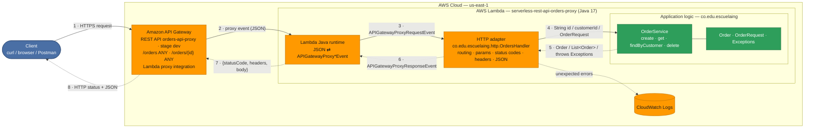

| Component | Depends on AWS? | Why |
|---|---|---|
| Client | No | Any HTTP client. |
| API Gateway | **Yes**, it is an AWS service | Routing to the function and the HTTP endpoint. |
| Lambda Java runtime | **Yes**, it is part of AWS Lambda | Converts the JSON event into Java objects and back. |
| `OrdersHandler` (HTTP adapter) | **Yes**: `aws-lambda-java-core`, `aws-lambda-java-events`, Jackson | It is the only class that knows the API Gateway event format and HTTP. |
| `OrderService`, `Order`, `OrderRequest`, `Exceptions` | **No**: only `java.util` | Business logic. Runs unchanged in JUnit and in Lambda. |

### Compile-time dependencies

The dependency rule of the design is that dependencies point **inwards**. The adapter depends on the application; the application depends on nothing.

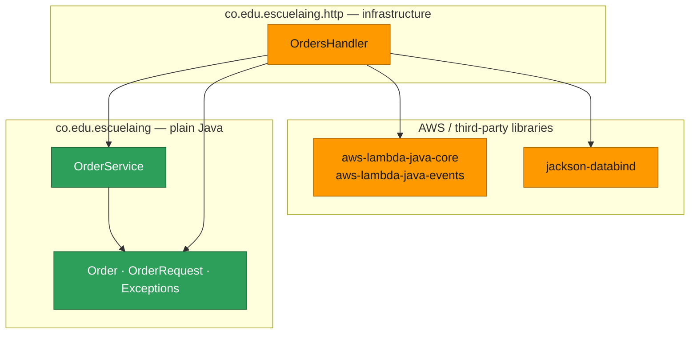

No arrow leaves the green box: the business classes import nothing from AWS, Jackson or HTTP. Architecture A (non-proxy, still deployed at `sat85gcah9`) is shown in [section 8](#8-part-iv--api-gateway-mapping-non-proxy-integration).

---

## 20. Reproducing the deployment and deliverables

### Build and test

Requirements: Java 17 and Maven 3.

```bash
mvn test        # 42 tests: 23 OrderServiceTest + 19 OrdersHandlerTest
mvn package     # shaded JAR with the AWS libraries and Jackson:
                # target/serverless-rest-api-with-aws-lambda-and-api-gateway-1.0-SNAPSHOT.jar
```

### Architecture B — proxy integration (final API)

1. **Lambda.** Create a function `serverless-rest-api-orders-proxy`: runtime **Java 17**, 512 MB. Upload the JAR. Set the handler to:
   ```
   co.edu.escuelaing.http.OrdersHandler::handleRequest
   ```
2. **API Gateway.** Create a **REST API** (`orders-api-proxy`, Regional):
   - resource `/orders`, method **ANY** → Lambda function, **Lambda proxy integration: ON**, function above;
   - resource `/orders/{id}`, method **ANY** → same configuration.

   Nothing else: no mapping templates, no integration or method responses.
3. **Deploy API** → stage `dev`.
4. Test with the requests in the [quick start](#quick-start) or [section 18](#18-final-api).

Updating the code only requires uploading a new JAR to the function. API Gateway does not change, as the DELETE extension showed.

### Architecture A — mapping templates (kept for comparison)

| Lambda function | Handler |
|---|---|
| `serverless-rest-api-get-order` | `co.edu.escuelaing.OrderService::getOrder` |
| `serverless-rest-api-find-orders` | `co.edu.escuelaing.OrderService::getOrdersByCustomer` |
| `serverless-rest-api-create-order` | `co.edu.escuelaing.OrderService::createOrder` |

All three use the same JAR, Java 17. The REST API configuration is documented step by step in:
- [section 7](#7-part-iii--http-interface-with-api-gateway-get-ordersid): resources and the path-parameter template;
- [section 8](#8-part-iv--api-gateway-mapping-non-proxy-integration): the query and body templates, integration responses with regexes, error templates and method responses.

Each step has screenshots in `docs/`.

### Deliverables checklist

| Required | Where |
|---|---|
| Complete Java source code | `src/main/java` — business logic in `co.edu.escuelaing`, adapter in `co.edu.escuelaing.http` |
| Maven configuration | `pom.xml` (JUnit 5, Surefire, AWS Lambda libraries, Jackson, Shade) |
| Unit tests | `src/test/java` — 42 tests, run with `mvn test` |
| Lambda handler(s) | `OrdersHandler` (proxy); `OrderService` methods (non-proxy) |
| API Gateway configuration / reproduction | This section, plus sections 7, 8, 11 and their screenshots |
| Example requests and responses | Sections 5, 7, 9, 13, 17, 18; event sample in `events/` |
| Architecture diagram | Section 19 (final), section 8 (Architecture A), section 6 (Lambda only) |
| Answers to the architectural questions | Sections 2, 4, 6, 10, 14, 22 |
| Analysis of the AI assistant's decisions | Sections 15, 16 and 17 |
| Build and test instructions | [Quick start](#quick-start) and this section |

### How the evaluation criteria are covered

| Criterion | Evidence |
|---|---|
| API design | Contract in section 1: resources `/orders` and `/orders/{id}`, the query parameter as a filter, the 200/201/204/400/404/500 table |
| Functionality | `curl` results against both deployed APIs (sections 9, 13, 17, 18) |
| Java design | Business logic without AWS imports; adapter isolated in `http` (sections 12, 19) |
| Testing | 42 local tests, including every HTTP status of the adapter and the internal-error case |
| AWS integration | Lambda used directly with JSON (Part II), with mapping templates (A) and with proxy integration (B) |
| Architecture | Checkpoint 3 (section 10), comparison (section 14), responsibilities (section 22) |
| AI-assisted development | Sections 15–17: what was delegated, critique of four decisions and of two wrong instructions, prediction vs proposal |
| Understanding | Every investigation was verified against the deployed behavior, including the failures (orphan 200 response, missing deploy, proxy switch off, `Location` without stage) |

---

## 21. Demonstration

📹 **Video:** [https://youtu.be/SnaeQFPZY9A](https://youtu.be/SnaeQFPZY9A)

The video follows this order:

| # | What is shown | Command / action |
|---|---|---|
| 1 | Unit tests run locally | `mvn test` → `Tests run: 42, Failures: 0` |
| 2 | Packaging | `mvn package` → shaded JAR in `target/` |
| 3 | Direct Lambda invocation | Lambda console → `serverless-rest-api-get-order` → Test with event `"ORD-42"` |
| 4 | Successful POST | `curl -i -X POST $API/orders ...` → `201` + `Location` |
| 5 | Successful GET | `curl -i $API/orders/ORD-43` → `200` |
| 6 | 404 | `curl -i $API/orders/ORD-999` → `404 ORDER_NOT_FOUND` |
| 7 | 400 | `curl -i -X POST ... "quantity":0` → `400 INVALID_QUANTITY` |
| 8 | DELETE extension | `DELETE /orders/ORD-44` → `204`, then `GET /orders/ORD-44` → `404` |
| 9 | Architecture diagram | Section 19 of this README rendered on GitHub |

---

## 22. The main question: where should each responsibility live?

Throughout the workshop I tried to answer, for every piece of behavior: *is this API Gateway, the Lambda/HTTP adapter, or application logic, and why?* This is where I ended up, and why.

| Responsibility | Where it lives | Why there |
|---|---|---|
| TLS, public endpoint, stages | **API Gateway** | Pure infrastructure. No code should deal with it. |
| Choosing which function handles a request | **API Gateway** (`/orders`, `/orders/{id}` → one Lambda) | It is the entry point. A coarse route per resource is enough. |
| Rejecting paths that do not exist at all | **API Gateway** | The request never needs to cost a Lambda invocation. |
| Authentication, throttling (if added) | **API Gateway** | Cross-cutting edge concerns, the same for every operation. |
| Choosing the operation by method (GET/POST/DELETE) and returning 405 | **HTTP adapter** | It depends on the API contract, which changes with the code. It should be versioned and tested with it. |
| Reading path/query parameters and the body | **HTTP adapter** | It is translation from HTTP to Java. In Architecture A this was VTL in the console; in Java it is testable and refactorable. |
| Parsing JSON and rejecting malformed bodies (400) | **HTTP adapter** | Malformed input is an HTTP-level problem; the domain should receive well-typed objects. |
| Validating business rules (quantity > 0, required fields) | **Application logic** (`OrderRequest.validate()`) | These rules are true no matter how the request arrives: JUnit, Lambda direct invocation, mapping template or proxy. |
| Creating, finding, deleting orders; generating ids | **Application logic** (`OrderService`) | This *is* the domain. The DELETE extension confirmed it: the logic went here without touching the infrastructure. |
| "This order does not exist" | **Application logic** (throws `ORDER_NOT_FOUND`) | The domain knows *what* happened… |
| "…therefore 404" / "deleted, therefore 204" / "created, therefore 201 + Location" | **HTTP adapter** | …but only the HTTP layer knows *how to say it* in HTTP. The domain never mentions status codes. |
| The error body format `{error, message}` and hiding internal details | **HTTP adapter** | One translation point guarantees a consistent contract and that stack traces never leak. |
| Errors that happen before or outside our code (Lambda crash, throttling, unknown route) | **API Gateway** (Gateway Responses) | Our code never runs in those cases, so only the gateway can format them. |
| Storage | **Should be** a repository behind `OrderService` (e.g. DynamoDB) | The in-memory list was only acceptable for the workshop. Lambda environments are ephemeral and not shared, as Parts II–IV demonstrated. |

**My position.** The design I can defend is **B with a clear layering**:
- API Gateway does edge work that is the same for every request;
- a thin, tested adapter owns everything that is specific to HTTP;
- the application logic owns everything that would still be true if HTTP disappeared tomorrow.

Architecture A taught me that putting HTTP behavior into API Gateway works, but hides it in untested console configuration, couples it to message strings, and spreads one request across many screens. Architecture B moves that behavior into code. That code depends on AWS, so I kept it in its own package and verified that no AWS import reaches the domain.

**What I would change next:**
- replace the in-memory list with a repository interface plus a DynamoDB implementation;
- describe the API Gateway and Lambda configuration as code (SAM or CDK) instead of console clicks;
- configure Gateway Responses so that even AWS-generated errors follow the `{error, message}` contract;
- if the API grew well beyond a handful of routes, replace the hand-written router with a small routing abstraction.

A working endpoint was never the goal. The goal was a solution where I can point at any behavior and explain why it lives where it does.
